[](https://codecov.io/github/SB14-ikujo/sb14-deokhugam-team02)

<div align="center">

<a href="http://deokhugam-alb-742426925.ap-northeast-2.elb.amazonaws.com/#/"></a>

# 📚 DEOKHUGAM

### 책 사진 한 장으로 ISBN을 찾아 도서를 등록하고, 리뷰로 소통하는 도서 리뷰 서비스

</div>

<br>

## 📝 프로젝트 소개

**덕후감**은 도서 정보를 간편하게 등록하고, 사용자 간 리뷰와 소통을 지원하는 **도서 리뷰 백엔드 서비스**입니다.
OCR 기반 ISBN 인식과 외부 도서 API 연동으로 도서 등록 과정을 간소화하고, 리뷰·좋아요·댓글·알림 기능을 통해 사용자 간 상호작용을 지원합니다.
또한 **Spring Batch** 기반의 주기적인 데이터 집계를 통해 인기 도서, 인기 리뷰, 파워 유저 순위를 일간·주간·월간·역대 기준으로 제공합니다.

| 구분       | 내용                                                                                 |
|----------|------------------------------------------------------------------------------------|
| 📅 개발 기간 | 2026.09.29 ~ 2026.11.06                                                            |
| 🌐 배포 주소 | [덕후감 서비스 바로가기](http://deokhugam-alb-742426925.ap-northeast-2.elb.amazonaws.com/#/) |

## 🛠 기술 스택

| 구분            | 기술                                                                                                                                                                                                                                                                                                                                                                                                                                                                                                                                                                                                                                                                                                            |
|:--------------|:--------------------------------------------------------------------------------------------------------------------------------------------------------------------------------------------------------------------------------------------------------------------------------------------------------------------------------------------------------------------------------------------------------------------------------------------------------------------------------------------------------------------------------------------------------------------------------------------------------------------------------------------------------------------------------------------------------------|
| 💻 언어 · 빌드    |                                                                                                                                                                                                                                                                                                                                                                                                                                                                                          |
| 🌱 프레임워크      |       |
| 🗄 데이터        |                                                                                                                                                                                                                                                                                                                                                                                  |
| 🔌 외부 연동      |                                                                                                                                                                                                                                                                                                                                                                                         |
| 🧰 라이브러리      |                                                                                                                                                                                                                                                           |
| 🧪 테스트 코드     |                                                                                                                                                                                                                                                                                                                                                                                                                                                                                                                                                                                                          |
| 📈 커버리지 관리    |                                                                                                                                                                                                                                                                                                                                                                                                                                                                                                                    |
| 🧹 코드 품질 · 리뷰 |                                                                                                                                                                                                                                                         |
| 📜 로깅         |                                                                                                                                                                                                                                                                                      |
| ☁️ 인프라 · 배포   |                                                                                                                                                |
| ⚙️ CI/CD      |                                                                                                                                                                                                                                                                                                                                                                                                                                                                                                                                                                                     |
| 🤝 협업툴        |                                                                                                                                                                                                                                |

## 👥 팀원별 소개

<table align="center">
<tr>
  <td align="center" width="180">
    <a href="https://github.com/xian980"></a><br/>
    <a href="https://github.com/xian980"></a>
  </td>
  <td align="center" width="180">
    <a href="https://github.com/SB-14-KSJ"></a><br/>
    <a href="https://github.com/SB-14-KSJ"></a>
  </td>
  <td align="center" width="180">
    <a href="https://github.com/yyy2724"></a><br/>
    <a href="https://github.com/yyy2724"></a>
  </td>
  <td align="center" width="180">
    <a href="https://github.com/pengji-dev"></a><br/>
    <a href="https://github.com/pengji-dev"></a>
  </td>
  <td align="center" width="180">
    <a href="https://github.com/ziezz767"></a><br/>
    <a href="https://github.com/ziezz767"></a>
  </td>
  <td align="center" width="180">
    <a href="https://github.com/EUNSOLY"></a><br/>
    <a href="https://github.com/EUNSOLY"></a>
  </td>
</tr>
<tr>
  <td align="center" valign="top"><b>강성준</b><br/><br/><sub><kbd><b>사용자&nbsp;도메인</b></kbd><br/>·&nbsp;회원가입&nbsp;·&nbsp;로그인<br/>·&nbsp;사용자&nbsp;조회&nbsp;·&nbsp;닉네임&nbsp;수정<br/>·&nbsp;논리&nbsp;삭제&nbsp;·&nbsp;물리&nbsp;삭제&nbsp;스케줄러<br/><kbd><b>헬퍼</b></kbd>&nbsp;🤝<br/>·&nbsp;도서&nbsp;상세&nbsp;조회&nbsp;API</sub></td>
  <td align="center" valign="top"><b>김세중</b><br/><br/><sub><kbd><b>댓글&nbsp;도메인</b></kbd><br/>·&nbsp;댓글&nbsp;CRUD&nbsp;·&nbsp;목록&nbsp;조회<br/>·&nbsp;부적절한&nbsp;단어&nbsp;필터링<br/>·&nbsp;댓글&nbsp;알림&nbsp;연결<br/><kbd><b>공통</b></kbd><br/>·&nbsp;README&nbsp;문서&nbsp;정리</sub></td>
  <td align="center" valign="top"><b>김양현</b><br/><br/><sub><kbd><b>대시보드&nbsp;도메인</b></kbd><br/>·&nbsp;인기&nbsp;도서&nbsp;·&nbsp;리뷰&nbsp;·&nbsp;파워&nbsp;유저&nbsp;집계<br/><kbd><b>심화</b></kbd>&nbsp;🚀<br/>·&nbsp;Spring&nbsp;Batch&nbsp;스케줄러<br/>·&nbsp;OCR&nbsp;ISBN&nbsp;인식&nbsp;API<br/><kbd><b>공통</b></kbd><br/>·&nbsp;헥사고날&nbsp;패키지&nbsp;설계<br/>·&nbsp;중앙&nbsp;예외&nbsp;처리<br/>·&nbsp;개발&nbsp;인프라&nbsp;구성</sub></td>
  <td align="center" valign="top"><b>김지현</b><br/><br/><sub><kbd><b>도서&nbsp;도메인</b></kbd><br/>·&nbsp;ISBN&nbsp;검증<br/>·&nbsp;도서&nbsp;등록&nbsp;·&nbsp;수정&nbsp;·&nbsp;삭제<br/>·&nbsp;카카오&nbsp;도서&nbsp;검색<br/>·&nbsp;썸네일&nbsp;처리</sub></td>
  <td align="center" valign="top"><b>박성욱</b><br/><br/><sub><kbd><b>리뷰&nbsp;·&nbsp;좋아요&nbsp;도메인</b></kbd><br/>·&nbsp;리뷰&nbsp;CRUD&nbsp;·&nbsp;목록&nbsp;조회<br/>·&nbsp;리뷰&nbsp;좋아요&nbsp;토글<br/>·&nbsp;좋아요&nbsp;알림&nbsp;연결<br/>·&nbsp;동시성&nbsp;제어<br/>·&nbsp;N+1&nbsp;개선&nbsp;·&nbsp;연쇄&nbsp;삭제<br/>·&nbsp;리뷰&nbsp;도메인&nbsp;테스트</sub></td>
  <td align="center" valign="top"><b>이은솔</b><br/><br/><sub><kbd><b>알림&nbsp;도메인</b></kbd><br/>·&nbsp;알림&nbsp;자동&nbsp;생성<br/>·&nbsp;알림&nbsp;조회&nbsp;·&nbsp;읽음&nbsp;처리<br/>·&nbsp;오래된&nbsp;알림&nbsp;삭제&nbsp;배치<br/><kbd><b>공통</b></kbd><br/>·&nbsp;AWS&nbsp;인프라&nbsp;구성<br/>·&nbsp;CD&nbsp;구축&nbsp;(무중단&nbsp;자동&nbsp;배포)<br/>·&nbsp;MDC&nbsp;로깅<br/>·&nbsp;이미지&nbsp;스토리지<br/>·&nbsp;환경별&nbsp;프로필&nbsp;관리<br/>·&nbsp;로그&nbsp;정기&nbsp;적재&nbsp;🚀<br/>·&nbsp;코드&nbsp;품질<br/><kbd><b>헬퍼</b></kbd>&nbsp;🤝<br/>·&nbsp;도서&nbsp;검색&nbsp;·&nbsp;정렬<br/>·&nbsp;리뷰&nbsp;집계&nbsp;동시성&nbsp;제어</sub></td>
</tr>
</table>

<p align="center"><sub>🤝 헬퍼 (본인 담당 도메인 외에 함께 구현한 부분) &nbsp; 🚀 심화 과제</sub></p>

## 🧩 구현 기능 상세

### 💬 댓글

**담당자** · [김세중](https://github.com/SB-14-KSJ)

- 댓글 CRUD — 본인만 수정 · 삭제
- 목록 — 시간순 정렬, 커서 페이지네이션
- 삭제 — 논리 삭제 기본, 물리 삭제 API 제공

<details>
<summary>📎 문서 · 서비스 상세 보기</summary>
<br>

| 📄 API 문서 (Swagger)                                                               | 🎞 서비스 상세 (GIF)                                                              |
|:----------------------------------------------------------------------------------|:-----------------------------------------------------------------------------|
| 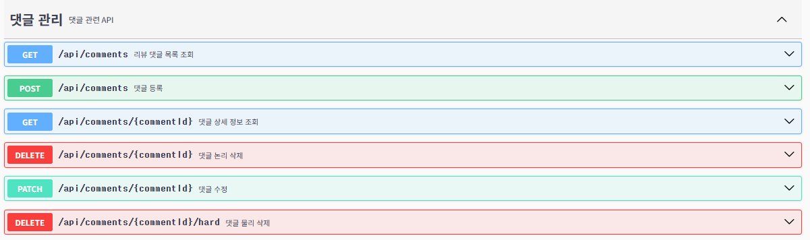 | 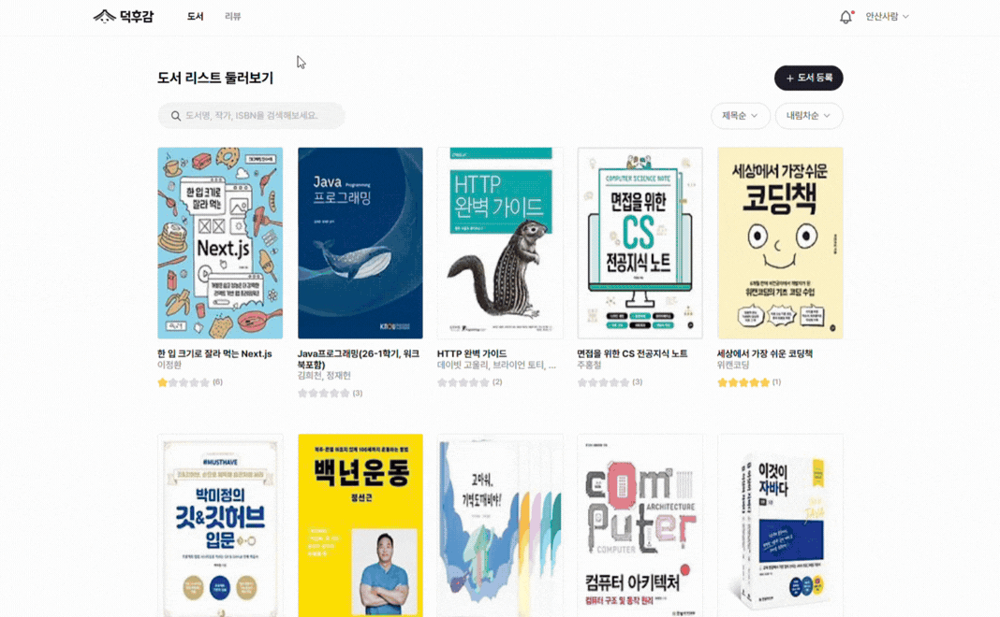 |

</details>

### 📚 도서 관리

**담당자** · [김지현](https://github.com/pengji-dev)

- 등록 — **ISBN 검증** 후 카카오 책 API로 조회해 등록, 같은 ISBN 중복 등록 불가
- CRUD — 도서 조회 · 수정 · 삭제 (ISBN은 수정 불가)
- 이미지 — 표지 이미지를 **S3**에 저장
- 검색 · 정렬 — 키워드(제목 · 저자 · ISBN) 검색, 정렬 4종(제목 · 출판일 · 평점 · 리뷰 수), 커서 페이지네이션
- 삭제 — 논리 삭제 기본, 물리 삭제 시 리뷰 · 댓글 등 연관 데이터 모두 삭제

<details>
<summary>📎 문서 · 서비스 상세 보기</summary>
<br>

| 📄 API 문서 (Swagger)                                                            | 🎞 서비스 상세 (GIF)                                                           |
|:-------------------------------------------------------------------------------|:--------------------------------------------------------------------------|
|  | 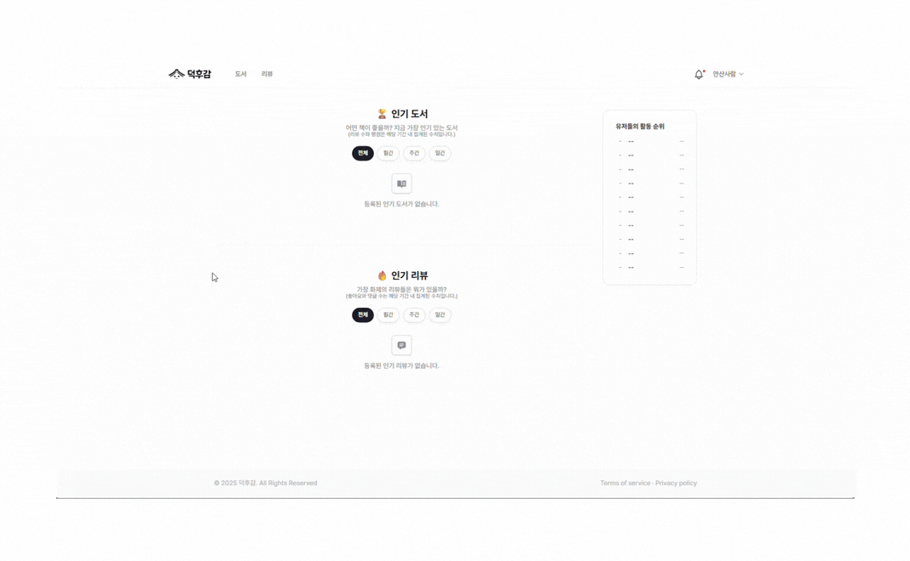 |

</details>

### ✍️ 리뷰 · 좋아요

**담당자** · [박성욱](https://github.com/ziezz767)

- 리뷰 CRUD — 도서당 1개 작성, 본인만 수정 · 삭제
- 삭제 — 논리 삭제 기본, 물리 삭제 시 좋아요 · 댓글도 함께 삭제
- 검색 · 정렬 — 키워드(닉네임 · 내용 · 도서 제목), 작성자 · 도서 필터, 정렬(작성일 · 평점), 커서 페이지네이션
- 좋아요 — 좋아요 / 취소, 내가 좋아요 했는지 여부(`likedByMe`)

<details>
<summary>📎 문서 · 서비스 상세 보기</summary>
<br>

| 📄 API 문서 (Swagger)                                                              | 🎞 서비스 상세 (GIF)                                                             |
|:---------------------------------------------------------------------------------|:----------------------------------------------------------------------------|
| 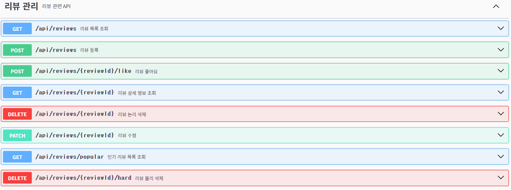 | 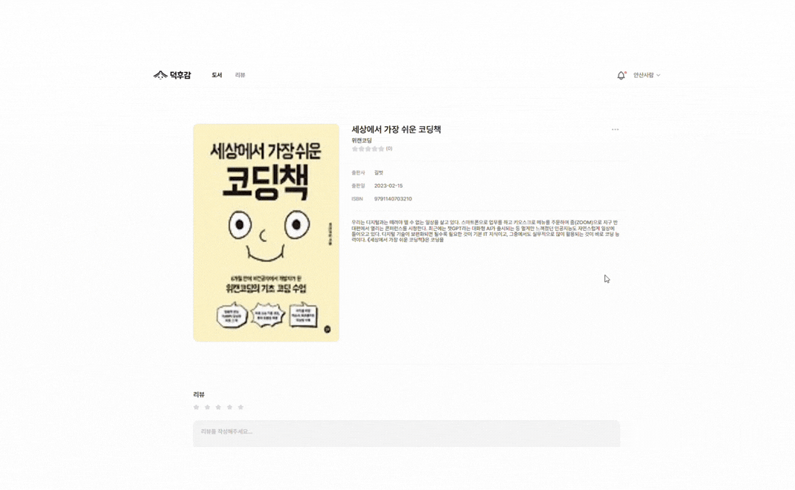 |

</details>

### 👤 사용자

**담당자** · [강성준](https://github.com/xian980)

- 가입 · 로그인 — 회원가입(이메일 중복 불가), 로그인(**BCrypt** 비밀번호 암호화)
- 동시 가입 처리 — 이메일 · 닉네임 유니크 제약 위반을 **409**로 변환
- 조회 · 수정 — 사용자 조회, 닉네임만 수정
- 삭제 — 논리 삭제 후 **1일 뒤 물리 삭제** (자동 삭제가 있는 유일한 도메인), 연관 데이터(리뷰 · 댓글 · 좋아요 · 알림) 모두 삭제

<details>
<summary>📎 문서 · 서비스 상세 보기</summary>
<br>

| 📄 API 문서 (Swagger)                                                             | 🎞 서비스 상세 (GIF)                                                            |
|:--------------------------------------------------------------------------------|:---------------------------------------------------------------------------|
| 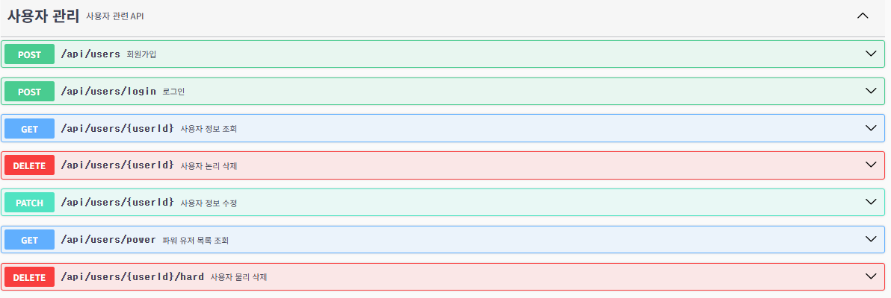 | 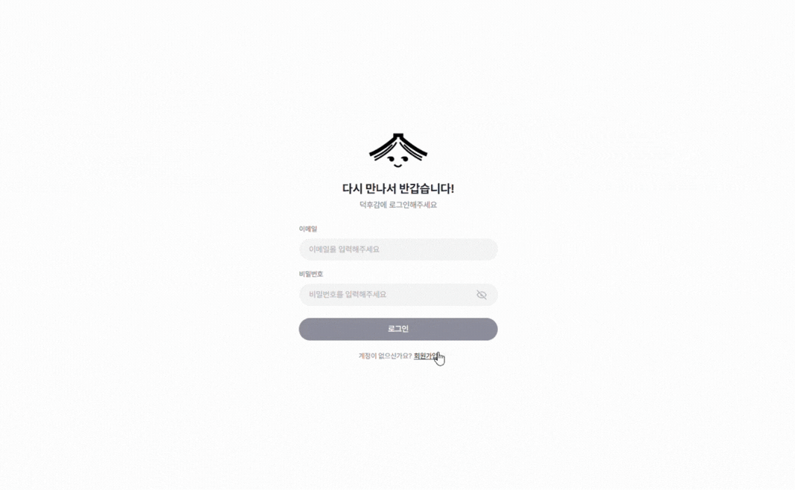 |

</details>

### 🔔 알림

**담당자** · [이은솔](https://github.com/EUNSOLY)

- 자동 생성 — 내 리뷰에 **좋아요 · 댓글**이 달렸을 때, 내 리뷰가 기간별 **인기 순위 10위** 안에 들었을 때
- 조회 · 읽음 — 목록 조회(최신순), 알림 하나 읽음, 전체 읽음
- 자동 정리 — 확인한 지 1주가 지난 알림을 매일 배치로 자동 삭제

<details>
<summary>📎 문서 · 서비스 상세 보기</summary>
<br>

| 📄 API 문서 (Swagger)                                                                    | 🎞 서비스 상세 (GIF)                                                                   |
|:---------------------------------------------------------------------------------------|:----------------------------------------------------------------------------------|
| 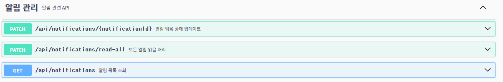 | 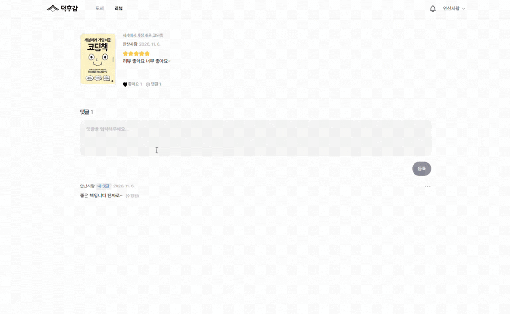 |

</details>

### 📊 대시보드 · OCR

**담당자** · [김양현](https://github.com/yyy2724)

- 집계 — 인기 도서 · 인기 리뷰 · 파워 유저를 **일간 · 주간 · 월간 · 역대** 기간별로 집계하고, 매일 배치로 스냅샷을 저장
- 순위 API — 인기 순위 조회 API 3개
- OCR — 책 표지 · 바코드 이미지에서 **ISBN 인식** (심화)

<details>
<summary>📎 문서 · 서비스 상세 보기</summary>
<br>

| 📄 API 문서 (Swagger)                                                                  | 🎞 서비스 상세 (GIF)                                                                 |
|:-------------------------------------------------------------------------------------|:--------------------------------------------------------------------------------|
| 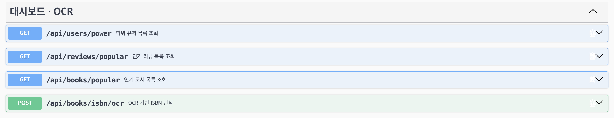 | 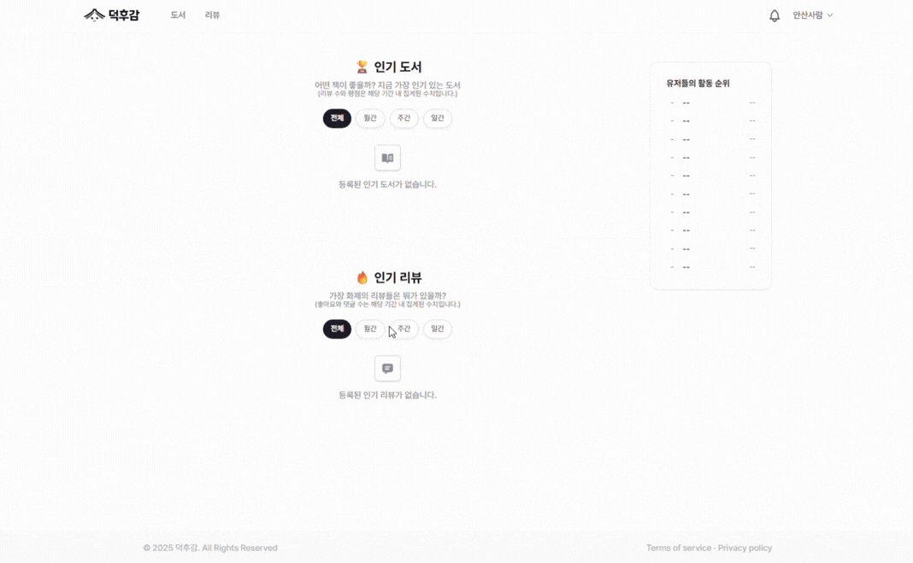 |

</details>

## 🗃 ERD

모든 테이블은 `BaseEntity` 의 `id(UUID)`, `created_at`, `updated_at` 을 공통으로 가집니다.

<p align="center">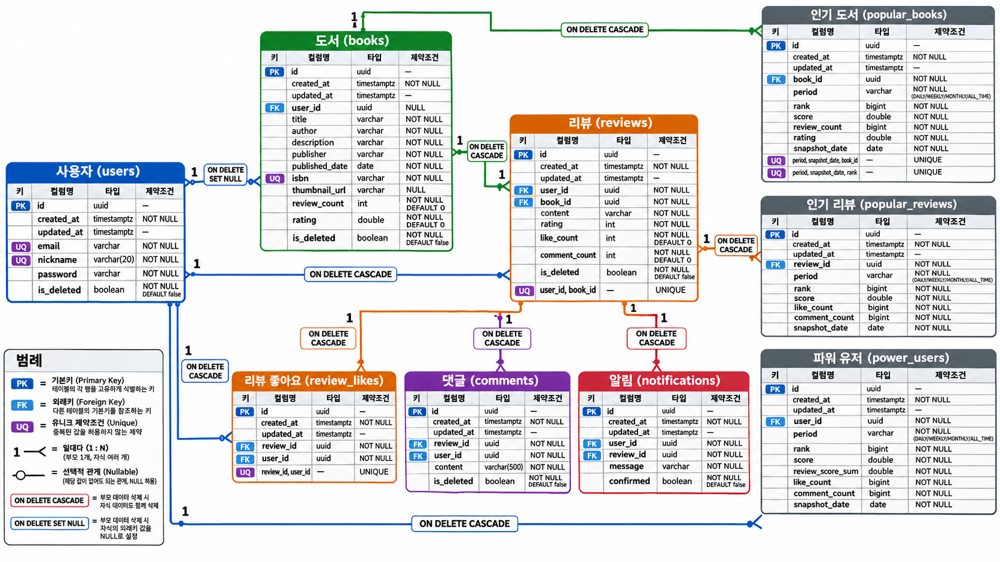</p>

<details>
<summary>[실제 ERD 보기]</summary>
<br>

<p align="center"></p>

</details>

- 사용자 · 도서 · 리뷰 · 댓글은 `is_deleted` 로 논리 삭제

## 📁 패키지 구조

백엔드는 **헥사고날 아키텍처(포트 & 어댑터)** 로 구성합니다. 도메인마다 `adapter` / `application.port` / `domain` 으로 나누고, 의존성은 항상 바깥(adapter)에서 안쪽(
domain)으로만 향합니다.
아래는 가장 구성이 큰 `book` 도메인을 펼친 예시이고, 나머지 도메인도 같은 구조입니다.

```
src
├── main
│   ├── java/com/sprint/deokhugam
│   │   ├── book                        # 📚 도서 (펼친 예시)
│   │   │   ├── adapter
│   │   │   │   ├── in
│   │   │   │   │   └── web             # BookController, BookApi(Swagger), dto, mapper
│   │   │   │   └── out
│   │   │   │       ├── kakao           # 카카오 책 검색 Adapter, config, dto
│   │   │   │       ├── external        # OcrSpaceClient (OCR.space)
│   │   │   │       └── storage         # AwsS3Storage, LocalStorage
│   │   │   ├── application
│   │   │   │   ├── dto                 # BookSearchResult, StoredThumbnail 등
│   │   │   │   └── port
│   │   │   │       ├── in              # BookUseCase · BookService, OcrUseCase · OcrService
│   │   │   │       └── out             # BookRepositoryPort, RepositoryCustom(QueryDSL), BookSearchPort, BookImageStorage, OcrClient
│   │   │   └── domain                  # Book
│   │   │       ├── exception           # BookException, BookErrorCode
│   │   │       └── validator           # IsbnValidator
│   │   ├── review                      # ✍️ 리뷰 · 좋아요
│   │   ├── comment                     # 💬 댓글
│   │   ├── user                        # 👤 사용자 (adapter.in.scheduler, adapter.out.security: BCrypt)
│   │   ├── notification                # 🔔 알림 (adapter.in.batch · scheduler)
│   │   ├── dashboard                   # 📊 인기 도서 · 인기 리뷰 · 파워 유저 (adapter.in.batch · scheduler)
│   │   └── common                      # 공통 (config, context, domain, exception, logging, pagination, util)
│   └── resources
│       ├── application.yml             # 공통 설정
│       ├── application-local.yml       # 로컬 환경 (Docker PostgreSQL, 로컬 스토리지)
│       ├── application-prod.yml        # 운영 환경 (AWS RDS, S3)
│       ├── logback-spring.xml          # 로그 패턴 (logstash.conf 와 짝)
│       └── static                      # 웹 화면 빌드 결과물
└── test/java/com/sprint/deokhugam      # 도메인별 단위 · 슬라이스 테스트 (main 과 같은 패키지 구조)
```

<p align="center">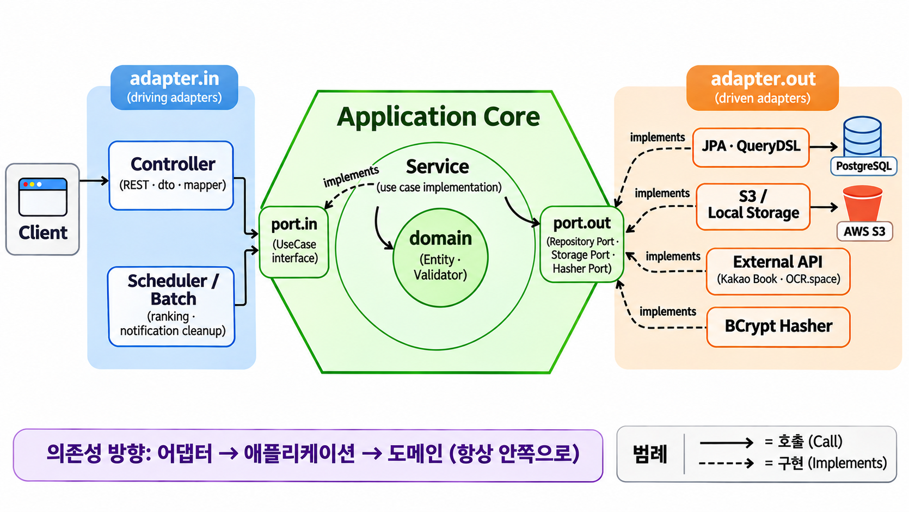</p>

## ☁️ 배포 구조

<p align="center">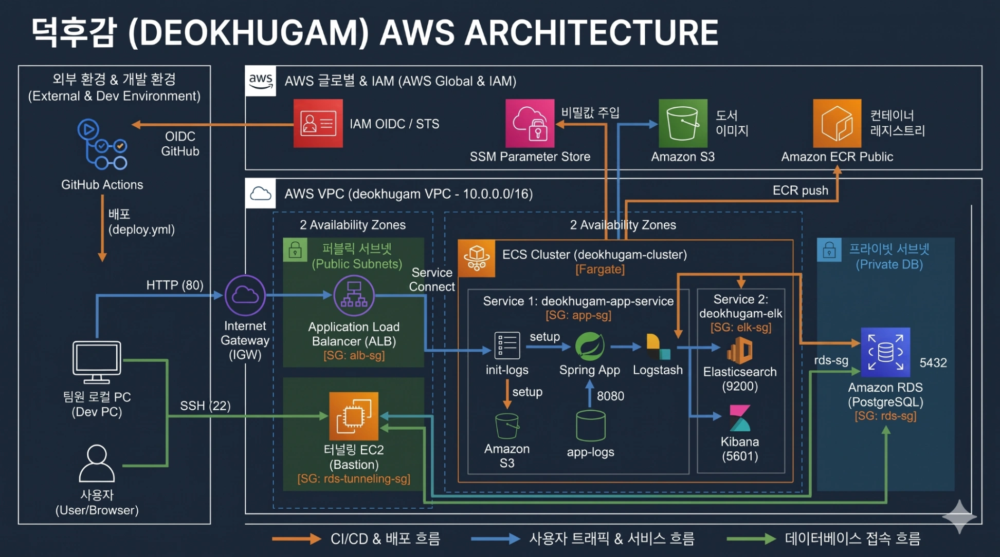</p>

## 🚀 시작하기

### 1. 준비 사항

- JDK 17
- Docker Desktop (PostgreSQL 이 compose 로 자동 기동되며, 테스트에도 필요)

Gradle 은 저장소에 포함된 Wrapper 를 사용합니다.

### 2. 저장소 받기

```bash
git clone <저장소 URL>
cd sb14-deokhugam-team02
```

### 3. 환경변수 설정

[.env.example](.env.example) 을 복사한 뒤 값을 채웁니다. `.env` 는 커밋하지 않습니다. 카카오·OCR.space 키가 없으면 도서 등록과 OCR 기능을 사용할 수 없습니다.

```bash
cp .env.example .env
```

```properties
POSTGRES_DB=deokhugam
POSTGRES_USER=deokhugam
POSTGRES_PASSWORD=change-me
# 도서 정보 조회 (카카오 책 검색 API)
KAKAO_REST_API_KEY=
# 이미지 저장소 (local | s3)
STORAGE_TYPE=local
STORAGE_PATH=./uploads
# AWS S3 (STORAGE_TYPE=s3 일 때만 필요)
AWS_S3_ACCESS_KEY=
AWS_S3_SECRET_KEY=
AWS_S3_REGION=
AWS_S3_BUCKET=
AWS_S3_PRESIGNED_URL_EXPIRATION=600
# OCR.space (ISBN 이미지 인식)
OCR_SPACE_API_KEY=
```

| 변수                                                                      | 설명                                    |
|-------------------------------------------------------------------------|---------------------------------------|
| `POSTGRES_DB` `POSTGRES_USER` `POSTGRES_PASSWORD`                       | DB 접속 정보                              |
| `KAKAO_REST_API_KEY`                                                    | 카카오 책 검색 API 키 (도서 등록에 필요)            |
| `STORAGE_TYPE`                                                          | 이미지 저장소 `local` \| `s3` (기본값 `local`) |
| `STORAGE_PATH`                                                          | 로컬 이미지 저장 경로 (기본값 `./uploads`)        |
| `AWS_S3_ACCESS_KEY` `AWS_S3_SECRET_KEY` `AWS_S3_REGION` `AWS_S3_BUCKET` | S3 설정 (`STORAGE_TYPE=s3` 일 때 필요)      |
| `AWS_S3_PRESIGNED_URL_EXPIRATION`                                       | Presigned URL 만료(초)                   |
| `OCR_SPACE_API_KEY`                                                     | OCR.space API 키 (ISBN 이미지 인식에 필요)     |

> 비밀번호·키는 `.env` 로만 관리하며 코드·yml 에 하드코딩하지 않습니다.

### 4. 실행

```bash
./gradlew bootRun
```

| 접속 대상      | 주소                                                                                         |
|------------|--------------------------------------------------------------------------------------------|
| 웹 화면       | [http://localhost:8080/](http://localhost:8080/)                                           |
| Swagger UI | [http://localhost:8080/swagger-ui/index.html](http://localhost:8080/swagger-ui/index.html) |

앱과 ELK 를 함께 띄우려면 다음 명령을 사용합니다.

```bash
docker compose -f docker-compose-logging-pipeline.yml --profile full up -d --build
```

현재 JPA 설정은 `ddl-auto: create` 이며, 애플리케이션을 실행할 때마다 테이블을 새로 만듭니다. 운영 환경에서는 데이터가 사라지므로 `validate` 또는 `none` 으로 바꿔야 합니다.

### 5. 빌드와 검사

```bash
# 테스트 · Checkstyle 을 포함한 빌드 (Docker 필요)
./gradlew build

# 테스트
./gradlew test

# 코드 스타일 검사
./gradlew checkstyleMain checkstyleTest
```

## ⚙️ 주요 구현

### 헥사고날 아키텍처 (포트 & 어댑터)

- 도메인마다 `adapter` / `application.port` / `domain` 으로 나누고, 의존성은 항상 **바깥 → 안쪽** 으로만 향합니다.
- 서비스는 `port.out` 인터페이스(`*RepositoryPort`, `BookImageStorage`, `PasswordHasher`)만 알고, 구현체는 `adapter.out` 이 제공합니다. (의존성
  역전)
- 덕분에 저장소(S3 ↔ 로컬)나 해시 방식을 바꿔도 비즈니스 로직은 그대로 유지됩니다.

### 커서 기반 페이지네이션 (QueryDSL)

- 도서 · 댓글 · 알림 · 대시보드 목록 조회를 **커서 방식** 으로 제공합니다. 데이터가 쌓여도 OFFSET 비용이 늘지 않습니다.
- `limit + 1` 개를 조회해 다음 페이지 유무를 판단하고(`SliceUtils`), `CursorPageResponse` 가 `nextCursor` · `nextAfter` · `hasNext` 를 공통
  형식으로 응답합니다.
- 복잡한 동적 검색 · 정렬은 `*RepositoryCustom` + QueryDSL 로 구현했습니다.

### 기간별 인기 랭킹 스냅샷 배치

| 랭킹    | 점수 산정                                    |
|-------|------------------------------------------|
| 인기 도서 | 리뷰 수 × 0.4 + 평점 × 0.6                    |
| 인기 리뷰 | 댓글 수 × 0.7 + 좋아요 수 × 0.3                 |
| 파워 유저 | 리뷰 점수 합 × 0.5 + 좋아요 수 × 0.2 + 댓글 수 × 0.3 |

- `PeriodType`(일간 · 주간 · 월간 · 역대)별로 집계 결과를 **스냅샷 테이블** 에 저장하고, 조회 API 는 최신 스냅샷을 읽어 응답합니다.
- `(period, snapshot_date, rank)` 등에 유니크 제약을 두어 같은 날짜 · 기간에 순위가 중복되지 않도록 보장합니다.
- 매일 KST 00:00 에 `BatchScheduler` 가 인기 도서 · 인기 리뷰를 집계하며, 한 집계가 실패해도 다른 집계는 계속 수행합니다(`runSafely`).
- 배치 전용 스레드 풀(`deokhugam-batch-`, 3개)과 공통 에러 핸들러로 여러 배치를 동시에 돌리고 예외를 한곳에서 로깅합니다.

### 알림 자동 생성 · 정리 스케줄러

- 매일 KST 01:00 에 인기 리뷰 알림을 생성합니다. 발송 주기는 `PeriodType.isNotifyDay` 로 판단합니다. (일간: 매일 / 주간: 월요일 / 월간: 매월 1일 / 역대: 발송 안 함)
- 읽은 알림은 매일 KST 00:00 에 자동 정리합니다.

### 논리 삭제 / 물리 삭제 분리

- 사용자 · 도서 · 리뷰 · 댓글은 `is_deleted` 로 **논리 삭제** 를 기본으로 하고, 리뷰 · 댓글은 `/hard` 엔드포인트로 **물리 삭제** 를 제공합니다.
- 물리 삭제 시 연관 데이터(좋아요 · 댓글 · 알림 등)를 함께 정리해 고아 데이터가 남지 않도록 합니다.

### 도서 이미지 스토리지 전환 구조

- `BookImageStorage` 포트 하나에 `AwsS3Storage`(S3 Presigned URL) 와 `LocalStorage` 두 구현체를 두고, `STORAGE_TYPE=local | s3` 설정만으로
  전환합니다.
- 로컬 개발에서는 AWS 계정 없이도 이미지 업로드를 테스트할 수 있습니다.

### ISBN 검증 · 도서 중복 방지

- `IsbnValidator` 로 ISBN 형식을 검증하고, ISBN 중복 등록과 ISBN 수정을 막아 도서 식별의 일관성을 유지합니다.
- 이미지에서 ISBN 을 인식하지 못한 경우를 위한 전용 에러 코드(`BOOK_OCR_FAILED`)가 정의되어 있습니다.

### OCR 기반 ISBN 인식 · 도서 등록 흐름

```
책 표지 · 바코드 이미지 ─▶ POST /api/books/isbn/ocr (OCR.space) ─▶ ISBN 추출
                         ─▶ GET /api/books/info (카카오 책 API) ─▶ POST /api/books 로 도서 등록
```

- `OcrClient` 포트의 구현체(`OcrSpaceClient`)가 OCR.space API 를 호출하고, 서비스는 포트만 알기 때문에 OCR 제공자를 교체해도 로직은 유지됩니다.
- 인식한 ISBN 은 `IsbnValidator` 로 검증한 뒤 카카오 책 API 로 도서 정보를 조회하고, 표지 이미지는 스토리지(`local` / `s3`)에 저장합니다.

### 통일된 예외 응답

- `ErrorCode` · `DeokhugamException` 을 기반으로 도메인마다 `*ErrorCode` · `*Exception` 을 두고, `GlobalExceptionController` 에서 한 형식(
  `ErrorResponse`)으로 응답합니다.

### 요청자 식별 · MDC 로깅 · ELK 파이프라인

- `Deokhugam-Request-User-ID` 헤더를 `MdcLoggingInterceptor` 가 읽어 `UserContextHolder` 에 저장하고, 컨트롤러에서는 `@RequestUserId` 로
  주입받습니다. (스레드 오염 방지를 위해 요청 종료 시 정리)
- `requestedIp` · `requestedUserId` · `requestMethod` · `requestUrl` 을 MDC 에 담아 Logback → Logstash → Elasticsearch →
  Kibana 로 수집 · 조회합니다.

### 코드 품질 자동화

- 에디터(`.editorconfig`) → 커밋(`pre-commit` 훅 Checkstyle) → PR(GitHub Actions) 3단계로 스타일을 검사합니다. (`maxWarnings = 0`)
- JaCoCo 라인 커버리지 80% 를 기준으로 하고, 커버리지 결과를 PR 코멘트로 남깁니다.
- 커밋 메시지 · 이슈 연결 · PR 대상 브랜치를 워크플로우로 검사하고, PR 이 열리면 Claude 가 한국어로 자동 리뷰합니다.

## 📏 개발 규칙

### 코드 스타일

에디터 → 커밋 → CI 세 단계에서 자동으로 맞추고 검사합니다.

| 단계  | 도구                     | 내용                                                                                             |
|-----|------------------------|------------------------------------------------------------------------------------------------|
| 에디터 | `.editorconfig`        | UTF-8, LF, 파일 끝 개행, Java·Gradle 4칸 / yml 2칸 들여쓰기                                               |
| 에디터 | IntelliJ 포매터           | `rule-config/intellij-formatter.xml` 을 가져와 통일 ([가이드](docs/code-style/INTELLIJ_SETUP_GUIDE.md)) |
| 빌드  | Checkstyle 12.3.0      | [네이버 핵데이 Java 컨벤션](https://naver.github.io/hackday-conventions-java) 기반, `maxWarnings = 0`     |
| 커밋  | `.githooks/pre-commit` | 커밋 전 Checkstyle 실행, 위반 시 커밋 차단                                                                 |
| 커밋  | `.githooks/commit-msg` | 커밋 메시지 `타입: 설명` 형식 검사                                                                          |
| PR  | GitHub Actions         | `ci.yml` 에서 Checkstyle 재검사, `pr-convention.yml` 로 커밋 메시지 검사                                    |

Gradle 동기화 시 `build.gradle` 이 git 훅 경로를 `.githooks` 로 자동 설정(`core.hooksPath`)하므로 별도 설치 명령은 없습니다. 위반 리포트는
`build/reports/checkstyle/` 에 생성됩니다.

### 커밋 메시지

```
<타입>: <설명>
```

| 타입         | 용도      | 예시                       |
|------------|---------|--------------------------|
| `feat`     | 신규 기능   | `feat: 도서 목록 조회 기능 추가`   |
| `fix`      | 버그 수정   | `fix: 리뷰 중복 작성 검증 오류 수정` |
| `refactor` | 리팩토링    | `refactor: 랭킹 집계 로직 분리`  |
| `test`     | 테스트     | `test: 댓글 목록 조회 테스트 추가`  |
| `docs`     | 문서      | `docs: README 작성`        |
| `chore`    | 환경설정·빌드 | `chore: 의존성 정리`          |

### 브랜치 전략과 CI/CD

```
작업 브랜치 ──PR──▶ develop ──PR──▶ main
```

- `main` 은 `develop` 에서 온 PR 만 허용합니다. (`pr-target-guard`)
- 이슈 템플릿 6종(feat/fix/refactor/test/docs/chore)과 PR 템플릿을 사용합니다.
- PR 이 열리면 Claude 가 자동 리뷰합니다. (참고용) 재리뷰는 PR 코멘트에 `@claude` 를 남깁니다.

| 워크플로우                 | 트리거                                    | 역할                                               |
|-----------------------|----------------------------------------|--------------------------------------------------|
| `ci.yml`              | PR(`develop`, `main`), push(`develop`) | Gradle 빌드 + 테스트 + Checkstyle, JaCoCo 커버리지 PR 코멘트 |
| `pr-convention.yml`   | PR 생성·수정                               | 커밋 메시지 규칙, 이슈 연결 검사                              |
| `pr-target-guard.yml` | PR(`main`)                             | `main` 대상 PR 의 출발 브랜치 검사                         |
| `claude-review.yml`   | PR 오픈(`develop`)                       | Claude 자동 코드 리뷰 (참고용, 한국어)                       |
| `claude.yml`          | PR 코멘트 `@claude`                       | 재리뷰 · 요청 처리                                      |

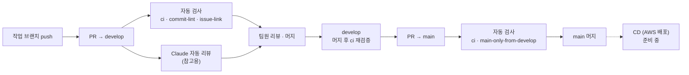

> ⚠️ CD(배포)는 아직 구성 중이라 현재 워크플로우에는 포함되어 있지 않습니다.

### 로깅 파이프라인

```
Spring App (Logback, MDC) ─▶ Logstash (grok) ─▶ Elasticsearch ─▶ Kibana
```

- `logback-spring.xml` 의 `LOG_PATTERN` 과 `logstash.conf` 의 grok 패턴은 **짝**입니다. 한쪽을 바꾸면 반드시 둘 다 수정하세요.
- MDC 키: `requestedIp`, `requestedUserId`, `requestMethod`, `requestUrl`

### 기타 규칙

- 테스트 커버리지: 라인 80% 이상 목표 ([JaCoCo 가이드](docs/test/JECOCO_GUIDE.md))
- `open-in-view: false` — 지연 로딩은 서비스 계층 트랜잭션 안에서 처리

## 🔗 관련 문서

- [환경변수 예시](.env.example)
- [애플리케이션 설정](src/main/resources/application.yml)
- [코드 스타일 가이드](docs/code-style)
- [로깅 인터셉터 가이드](docs/logging/LOGGING_INTERCEPTOR_GUIDE.md)
- [JaCoCo 가이드](docs/test/JECOCO_GUIDE.md)
- [이슈 템플릿](.github/ISSUE_TEMPLATE)
- [PR 템플릿](.github/PULL_REQUEST_TEMPLATE.md)
