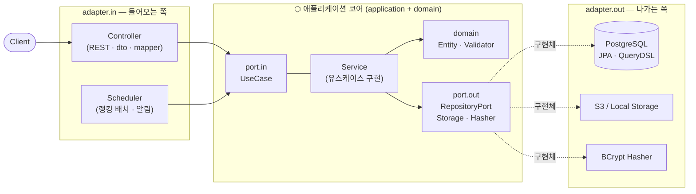
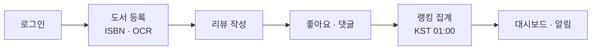
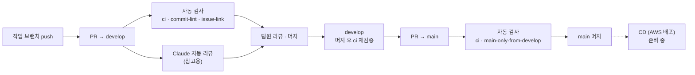

# 📚 덕후감 (Deokhugam)

> 도서 이미지 OCR 기반 ISBN 매칭 도서 리뷰 서비스
> 코드잇 스프린트 중급 프로젝트 · **2팀 이쿠조**

도서 표지·바코드 이미지를 올리면 ISBN을 인식해 도서 정보를 매칭하고, 리뷰·댓글·좋아요로 소통하며 인기 도서·인기 리뷰·파워 유저 랭킹을 확인할 수 있는 서비스입니다.

---

## 목차

1. [팀원 소개](#1-팀원-소개)
2. [기술 스택](#2-기술-스택)
3. [주요 기능](#3-주요-기능)
4. [패키지 구조](#4-패키지-구조)
5. [서비스 워크플로우](#5-서비스-워크플로우)
6. [ERD](#6-erd)
7. [CI/CD 워크플로우](#7-cicd-워크플로우)
8. [배포 구조](#8-배포-구조)
9. [로깅 파이프라인](#9-로깅-파이프라인)
10. [로컬 실행 방법](#10-로컬-실행-방법)
11. [코드 스타일](#11-코드-스타일)
12. [협업 규칙](#12-협업-규칙)

---

## 1. 팀원 소개

<table>
  <tr>
    <td align="center" width="16%">
      <br/>
      <b>은솔</b><br/>
      <sub>역할: (작성)</sub><br/>
      <sub>담당: (작성)</sub><br/>
      <a href="https://github.com/EUNSOLY">@EUNSOLY</a>
    </td>
    <td align="center" width="16%">
      <br/>
      <b>성준</b><br/>
      <sub>역할: (작성)</sub><br/>
      <sub>담당: (작성)</sub><br/>
      <a href="https://github.com/SungJun">@SungJun</a>
    </td>
    <td align="center" width="16%">
      <br/>
      <b>세중</b><br/>
      <sub>역할: (작성)</sub><br/>
      <sub>담당: (작성)</sub><br/>
      <a href="https://github.com/KSJ">@KSJ</a>
    </td>
    <td align="center" width="16%">
      <br/>
      <b>양현</b><br/>
      <sub>역할: (작성)</sub><br/>
      <sub>담당: (작성)</sub><br/>
      <a href="https://github.com/yyy2724">@yyy2724</a>
    </td>
    <td align="center" width="16%">
      <br/>
      <b>지현</b><br/>
      <sub>역할: (작성)</sub><br/>
      <sub>담당: (작성)</sub><br/>
      <a href="https://github.com/kjh940222">@kjh940222</a>
    </td>
    <td align="center" width="16%">
      <br/>
      <b>성욱</b><br/>
      <sub>역할: (작성)</sub><br/>
      <sub>담당: (작성)</sub><br/>
      <a href="https://github.com/ziezz767">@ziezz767</a>
    </td>
  </tr>
</table>


---

## 2. 기술 스택

| 구분        | 기술                                                                      |
|-----------|-------------------------------------------------------------------------|
| Language  | Java 17                                                                 |
| Framework | Spring Boot 4.1.1, Spring Web MVC, Spring Data JPA, Spring Validation   |
| Query     | QueryDSL 7.0 (커서 기반 페이지네이션, 동적 검색)                                      |
| Mapping   | MapStruct 1.6.3, Lombok                                                 |
| Security  | spring-security-crypto (BCrypt 비밀번호 해시)                                 |
| Database  | PostgreSQL 15                                                           |
| Storage   | AWS S3 (SDK v2, Presigned URL) / 로컬 파일 시스템 (`STORAGE_TYPE=local \| s3`) |
| API 문서    | springdoc-openapi (Swagger UI) 3.1.1                                    |
| Build     | Gradle 9.7.1 (wrapper)                                                  |
| Test / 품질 | JUnit 5, Spring Test, JaCoCo (라인 커버리지 80%), Checkstyle 12.3.0           |
| Infra     | Docker (멀티스테이지 빌드), Docker Compose, AWS S3 (배포 인프라는 구성 중)               |
| CI/CD     | GitHub Actions                                                          |
| Logging   | Logback + MDC, ELK (Elasticsearch · Logstash · Kibana)                  |
| AI 도구     | Claude Code Action (PR 자동 리뷰, 한국어)                                      |

---

## 3. 주요 기능

> 📸 이미지는 추후 첨부 예정입니다. `docs/images/features/<기능>-api.png`(OpenAPI Docs), `<기능>-screen.png`(서비스 화면)를 같은 이름으로 덮어쓰면 됩니다.

### 👤 사용자 `/api/users`

- 회원가입 / 로그인 (BCrypt 해시)
- 사용자 조회 · 닉네임 수정 · 논리 삭제

<table>
  <tr>
    <td align="center" width="50%"><b>OpenAPI Docs</b><br/></td>
    <td align="center" width="50%"><b>서비스 화면</b><br/></td>
  </tr>
</table>

### 📖 도서 `/api/books`

- 도서 등록 (ISBN 검증 `IsbnValidator`, 썸네일 이미지 업로드)
- 도서 목록 조회 — 제목/저자/ISBN 검색(대소문자 무시), 정렬, 커서 페이지네이션
- 리뷰 수·평점 집계 반영

<table>
  <tr>
    <td align="center" width="50%"><b>OpenAPI Docs</b><br/></td>
    <td align="center" width="50%"><b>서비스 화면</b><br/></td>
  </tr>
</table>

### ✍️ 리뷰 `/api/reviews`

- 리뷰 작성 · 수정 · 조회 (도서당 사용자 1개 제한: `UNIQUE(user_id, book_id)`)
- 논리 삭제 / 물리 삭제(`/hard`)
- 리뷰 좋아요 토글

<table>
  <tr>
    <td align="center" width="50%"><b>OpenAPI Docs</b><br/></td>
    <td align="center" width="50%"><b>서비스 화면</b><br/></td>
  </tr>
</table>

### 💬 댓글 `/api/comments`

- 댓글 등록 · 목록(커서 페이지네이션) · 상세 · 수정
- 논리 삭제 / 물리 삭제(`/hard`)

<table>
  <tr>
    <td align="center" width="50%"><b>OpenAPI Docs</b><br/></td>
    <td align="center" width="50%"><b>서비스 화면</b><br/></td>
  </tr>
</table>

### 🏆 대시보드 `/api`

| API                    | 설명    | 점수 산정                 |
|------------------------|-------|-----------------------|
| `GET /books/popular`   | 인기 도서 | 리뷰 수 × 0.4 + 평점 × 0.6 |
| `GET /reviews/popular` | 인기 리뷰 | 좋아요 × 0.3 + 댓글 × 0.7  |
| `GET /users/power`     | 파워 유저 | 리뷰 점수 합·좋아요·댓글 기반     |

- 기간(`PeriodType`) 별 랭킹을 배치 스케줄러가 매일 **KST 01:00** 에 스냅샷으로 저장

<table>
  <tr>
    <td align="center" width="50%"><b>OpenAPI Docs</b><br/></td>
    <td align="center" width="50%"><b>서비스 화면</b><br/></td>
  </tr>
</table>

### 🔔 알림 `/api/notifications`

- 인기 리뷰 선정 시 알림 생성 (스케줄러)
- 알림 단건 / 전체 읽음 처리, 목록 조회
- 읽은 알림 자동 정리 (매일 KST 00:00)

<table>
  <tr>
    <td align="center" width="50%"><b>OpenAPI Docs</b><br/></td>
    <td align="center" width="50%"><b>서비스 화면</b><br/></td>
  </tr>
</table>

### 🧱 공통

- 통일된 예외 응답 (`ErrorCode`, `GlobalExceptionController`)
- 요청 단위 MDC 로깅 (`requestedIp`, `requestedUserId`, `requestMethod`, `requestUrl`)
- 커서 기반 페이지 응답 (`CursorPageResponse`)

---

## 4. 패키지 구조

이 프로젝트는 **헥사고날 아키텍처(포트 & 어댑터)** 로 구성되어 있습니다. 도메인 단위로 패키지를 나누고, 각 도메인 안에서 `adapter` / `application.port` / `domain` 세
영역으로 분리합니다. 루트: `com.sprint.deokhugam`

- **domain** : 엔티티·검증·도메인 예외. 다른 영역을 알지 못합니다.
- **application.port.in** : 유스케이스 인터페이스(`*UseCase`)와 구현(`*Service`). 비즈니스 흐름을 담당합니다.
- **application.port.out** : 서비스가 외부에 요구하는 인터페이스(`*RepositoryPort`, `BookImageStorage`, `PasswordHasher`).
- **adapter.in** : 외부 → 앱 진입점 (REST Controller, 스케줄러).
- **adapter.out** : 앱 → 외부 구현체 (S3/로컬 스토리지, BCrypt).
- 의존성은 항상 **바깥(adapter) → 안쪽(domain)** 으로만 향합니다.



| 방향       | 설명                                                            |
|----------|---------------------------------------------------------------|
| 실선 `→`   | 호출 방향. 항상 바깥(adapter)에서 안쪽(core)으로 의존                         |
| 점선 `-.→` | 코어는 `port.out` 인터페이스만 알고, 실제 구현체는 `adapter.out` 이 제공 (의존성 역전) |

> 코어(application + domain)는 Spring MVC·S3·BCrypt 같은 외부 기술을 직접 알지 못하므로, 어댑터만 교체해도 비즈니스 로직은 그대로 유지됩니다.

> `common` 패키지(config, exception, logging, pagination 등)는 모든 도메인이 공유합니다.

```
com.sprint.deokhugam
├── book                      # 도서
│   ├── adapter
│   │   ├── in.web            # Controller, Api(Swagger), dto, mapper
│   │   └── out               # AwsS3Storage, LocalStorage, 스토리지 예외
│   ├── application.port
│   │   ├── in                # BookUseCase, BookService
│   │   └── out               # RepositoryPort, RepositoryCustom(QueryDSL), BookImageStorage
│   └── domain                # Book, validator(IsbnValidator), exception
├── review                    # 리뷰 · 좋아요 (동일 구조)
├── comment                   # 댓글 (동일 구조)
├── user                      # 사용자 (adapter.out.security: BCryptPasswordHasher)
├── notification              # 알림 (adapter.in.scheduler 포함)
├── dashboard                 # 인기 도서 / 인기 리뷰 / 파워 유저
│   ├── adapter.in            # web, scheduler(BatchScheduler)
│   ├── application.port      # in(popularbook, popularreview), out(popularbook, popularreview, poweruser)
│   └── domain                # PopularBook, PopularReview, PowerUser, PeriodType, Ranker
└── common
    ├── config                # Swagger, JPA, QueryDSL, Scheduler, WebMvc, AwsS3
    ├── context.user          # @RequestUserId, ArgumentResolver
    ├── domain                # BaseEntity (UUID id, createdAt, updatedAt)
    ├── exception             # ErrorCode, DeokhugamException, GlobalExceptionController
    ├── logging               # MdcLoggingInterceptor, LogLevelHighlightConverter
    ├── pagination            # CursorPageResponse
    └── util                  # SliceUtils
```

```
.
├── .github/workflows         # ci, claude-review, claude, pr-convention, pr-target-guard
├── .githooks                 # commit-msg, pre-commit
├── docs                      # 코드 스타일 · 로깅 · 테스트 · 배포 아키텍처 문서
├── rule-config               # checkstyle, intellij formatter
├── Dockerfile
├── docker-compose-logging-pipeline.yml
├── logstash.conf
└── src/main/resources        # application.yml, logback-spring.xml, static(프론트 빌드 산출물)
```

---

## 5. 서비스 워크플로우



---

## 6. ERD

모든 테이블은 `BaseEntity` 의 `id(UUID)`, `created_at`, `updated_at` 을 공통으로 가집니다.

> 📸 이미지는 추후 첨부 예정입니다. `docs/images/erd.png` 를 같은 이름으로 덮어쓰면 됩니다.

<p align="center"></p>

- `reviews` : `UNIQUE(user_id, book_id)` — 한 사용자는 도서당 리뷰 1개
- 사용자·도서·리뷰·댓글은 `is_deleted` 로 논리 삭제

---

## 7. CI/CD 워크플로우

### 브랜치 전략

```
작업 브랜치 ──PR──▶ develop ──PR──▶ main
```

- `main` 은 `develop` 에서 온 PR 만 허용 (`pr-target-guard`)
- 커밋 형식: `feat:` `fix:` `refactor:` `test:` `docs:` `chore:` + 설명 (`pr-convention` 으로 검사)

### GitHub Actions 워크플로우

| 워크플로우                 | 트리거                                    | 역할                                               |
|-----------------------|----------------------------------------|--------------------------------------------------|
| `ci.yml`              | PR(`develop`, `main`), push(`develop`) | Gradle 빌드 + 테스트 + Checkstyle, JaCoCo 커버리지 PR 코멘트 |
| `pr-convention.yml`   | PR 생성·수정                               | 커밋 메시지 규칙, 이슈 연결 검사                              |
| `pr-target-guard.yml` | PR(`main`)                             | `main` 대상 PR 의 출발 브랜치 검사                         |
| `claude-review.yml`   | PR 오픈 (`develop`)                      | Claude 자동 코드 리뷰 (참고용, 한국어)                       |
| `claude.yml`          | PR 코멘트 `@claude`                       | 재리뷰 · 요청 처리                                      |

### CI / CD 흐름



- `ci` : Gradle 빌드 · 테스트 · Checkstyle, JaCoCo 커버리지를 PR 코멘트로 남김
- `commit-lint` / `issue-link` : 커밋 메시지 형식, 이슈 연결 검사
- `main-only-from-develop` : `main` 으로는 `develop` 에서 온 PR 만 허용
- 재리뷰가 필요하면 PR 코멘트에 `@claude`

> ⚠️ CD(AWS 배포)는 아직 구성 중이라 현재 워크플로우에는 포함되어 있지 않습니다. 확정되면 추가합니다.

---

## 8. 배포 구조

> 🚧 AWS 배포 구조는 현재 구성 중입니다. 확정되면 이미지와 함께 업데이트합니다.

> 📸 이미지는 추후 첨부 예정입니다. `docs/images/deploy-architecture.png` 를 같은 이름으로 덮어쓰면 됩니다.

<p align="center"></p>

---

## 9. 로깅 파이프라인

```
Spring App (Logback, MDC) ─▶ Logstash (grok) ─▶ Elasticsearch ─▶ Kibana
```

- `logback-spring.xml` 의 `LOG_PATTERN` 과 `logstash.conf` 의 grok 패턴은 **짝**입니다. 한쪽을 바꾸면 반드시 둘 다 수정하세요.
- MDC 키: `requestedIp`, `requestedUserId`, `requestMethod`, `requestUrl`
- 자세한 내용: [docs/logging/LOGGING_INTERCEPTOR_GUIDE.md](docs/logging/LOGGING_INTERCEPTOR_GUIDE.md)

---

## 10. 로컬 실행 방법

**사전 준비**: JDK 17, Docker Desktop

```bash
# 1. 환경 변수 설정 (.env 는 커밋 금지)
cp .env.example .env
#    POSTGRES_PASSWORD 등 값 채우기

# 2. Docker Desktop 실행 후 앱 구동 (postgres 가 compose 로 자동 기동)
./gradlew bootRun

# 전체 (앱 + ELK)
docker compose -f docker-compose-logging-pipeline.yml --profile full up -d --build
```

| 항목         | 주소                                          |
|------------|---------------------------------------------|
| 앱          | http://localhost:8080                       |
| Swagger UI | http://localhost:8080/swagger-ui/index.html |

```bash
./gradlew build   # 빌드 + 테스트 + Checkstyle (테스트에 Docker 필요)
```

### 환경 변수 (`.env`)

| 키                                                                       | 설명                      |
|-------------------------------------------------------------------------|-------------------------|
| `POSTGRES_DB` `POSTGRES_USER` `POSTGRES_PASSWORD`                       | DB 접속 정보                |
| `AWS_S3_ACCESS_KEY` `AWS_S3_SECRET_KEY` `AWS_S3_REGION` `AWS_S3_BUCKET` | S3 설정                   |
| `AWS_S3_PRESIGNED_URL_EXPIRATION`                                       | Presigned URL 만료(초)     |
| `STORAGE_TYPE`                                                          | 이미지 저장소 `local` \| `s3` |

> 비밀번호·키는 `.env` 로만 관리하며 코드·yml 에 하드코딩하지 않습니다.

---

## 11. 코드 스타일

일관된 코드를 위해 **에디터 → 커밋 → CI** 세 단계에서 자동으로 맞추고 검사합니다.

| 단계  | 도구                     | 내용                                                                                                              |
|-----|------------------------|-----------------------------------------------------------------------------------------------------------------|
| 에디터 | `.editorconfig`        | UTF-8, LF, 파일 끝 개행, 줄 끝 공백 제거, Java·Gradle 4칸 / yml 2칸 들여쓰기(스페이스)                                               |
| 에디터 | IntelliJ 포매터           | `rule-config/intellij-formatter.xml` 를 가져와 Reformat Code 기준 통일                                                  |
| 빌드  | Checkstyle 12.3.0      | [네이버 핵데이 Java 컨벤션](https://naver.github.io/hackday-conventions-java) 기반 커스텀 규칙, `maxWarnings = 0` 으로 위반 시 빌드 실패 |
| 커밋  | `.githooks/pre-commit` | 커밋 전 `checkstyleMain` · `checkstyleTest` 실행, 위반 시 커밋 차단                                                         |
| 커밋  | `.githooks/commit-msg` | 커밋 메시지 `타입: 설명` 형식 검사                                                                                           |
| PR  | GitHub Actions         | `ci.yml` 의 `./gradlew build` 에서 Checkstyle 재검사, `pr-convention.yml` 로 커밋 메시지 검사                                 |

### 적용 방법
별도 명령 없이 **개발 환경만 셋업하면** 자동으로 적용됩니다.

1. IntelliJ 에 `rule-config/intellij-formatter.xml` 코드 스타일을 가져오기 ([INTELLIJ_SETUP_GUIDE.md](docs/code-style/INTELLIJ_SETUP_GUIDE.md))
2. 프로젝트를 열어 Gradle 동기화 — `build.gradle` 이 git 훅 경로를 `.githooks` 로 자동 설정 (`core.hooksPath`)
3. 이후 `git commit` 때마다 `pre-commit` 훅이 Checkstyle 을 실행하고, 위반이 있으면 커밋이 취소됩니다.

```
git commit → pre-commit(Checkstyle) → commit-msg(메시지 형식) → 커밋 완료
```

- 위반 리포트: `build/reports/checkstyle/main.html`, `test.html`
- 규칙별 설명은 [CHECK_STYLE.md](docs/code-style/CHECK_STYLE.md), Gradle 연동은 [GRADLE_CODE_STYPE.md](docs/code-style/GRADLE_CODE_STYPE.md) 참고

---

## 12. 협업 규칙

- 이슈 템플릿 6종(feat/fix/refactor/test/docs/chore) 과 PR 템플릿 사용
- `.githooks` 의 `commit-msg`, `pre-commit` 훅은 Gradle 동기화 시 자동 설정
- 코드 스타일: `.editorconfig` 와 Checkstyle 준수 ([docs/code-style](docs/code-style))
- 테스트 커버리지: 라인 80% 이상 목표 ([docs/test/JECOCO_GUIDE.md](docs/test/JECOCO_GUIDE.md))
- `open-in-view: false` — 지연 로딩은 서비스 계층 트랜잭션 안에서 처리
- PR 이 열리면 Claude 가 자동 리뷰합니다 (참고용). 재리뷰는 PR 코멘트에 `@claude`
