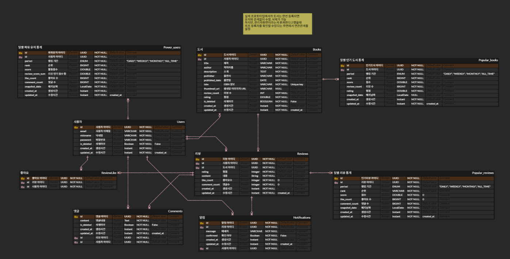
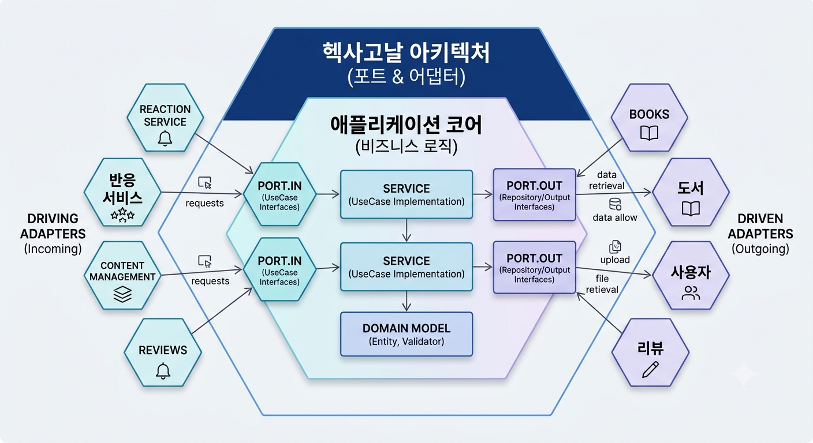
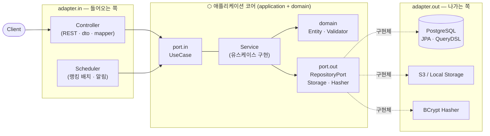
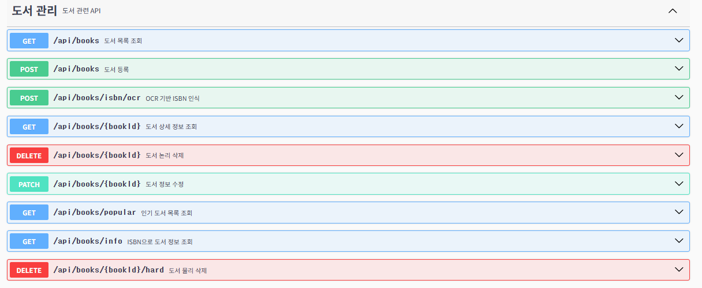
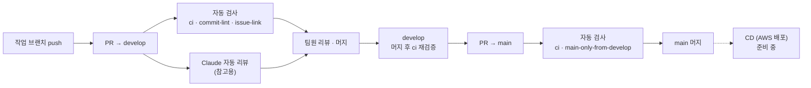

[](https://codecov.io/github/SB14-ikujo/sb14-deokhugam-team02)

<a href="http://deokhugam-alb-742426925.ap-northeast-2.elb.amazonaws.com/#/"></a>

**도서 이미지 OCR 기반 ISBN 매칭 도서 리뷰 서비스**

덕후감은 책 표지나 바코드 이미지에서 OCR 로 ISBN 을 인식하고, 외부 도서 API 와 매칭해 도서 정보를 손쉽게 등록하는 도서 리뷰 백엔드 서비스입니다. 사용자는 도서에 리뷰를 작성하고 다른 사용자의 리뷰에
좋아요와 댓글을 남길 수 있으며, 내 리뷰에 반응이 생기면 알림으로 받아볼 수 있습니다. 또한 Spring Batch 기반의 주기적인 집계로 인기 도서, 인기 리뷰, 파워 유저 순위를 일간 · 주간 · 월간 · 역대
기간별로 대시보드에 제공합니다.

## 기술 스택

| 구분             | 기술                                                                                                                                                                                                                                                                                                                                                                                                                                                                                                                                                                                 | 용도                                                               |
|----------------|------------------------------------------------------------------------------------------------------------------------------------------------------------------------------------------------------------------------------------------------------------------------------------------------------------------------------------------------------------------------------------------------------------------------------------------------------------------------------------------------------------------------------------------------------------------------------------|------------------------------------------------------------------|
| 언어             |                                                                                                                                                                                                                                                                                                                                                                                                                                                                              | 백엔드 구현                                                           |
| 프레임워크          |                                                                                                                                                                                                                         | REST API, 요청 검증, 정적 웹 화면 제공                                      |
| 데이터 접근         |                                                                                                                                                                                                                                                                                                                                                                            | 엔티티 관리, 동적 검색·정렬, 커서 페이지네이션                                      |
| 데이터베이스         |                                                                                                                                                                                                                                                                                                                                                                                                                                                               | 사용자·도서·리뷰·댓글·알림·랭킹 스냅샷 저장                                        |
| 외부 API         |                                                                                                                                                                                                                                                                                                                                                                                 | 도서 정보 조회(ISBN), 이미지 OCR 로 ISBN 인식                                |
| 스토리지           |                                                                                                                                                                                                                                                                                                                                                                                                                                                                 | 도서 표지 이미지 저장 (Presigned URL / 로컬 파일, `STORAGE_TYPE=local \| s3`) |
| 배치 · 모니터링      |                                                                                                                                                                                                                                                                                                                                                              | 랭킹 집계 배치 실행 기록(BATCH_* 테이블), health · metrics 노출                 |
| 스케줄링           |                                                                                                                                                                                                                                                                                                                                                                                                                                                             | 랭킹 집계, 인기 리뷰 알림, 읽은 알림 정리                                        |
| 매핑             |                                                                                                                                                                                                                                                                                                                                                                                                                    | DTO 변환, 반복 코드 축소                                                 |
| 보안             |                                                                                                                                                                                                                                                                                                                                                                                                                                       | BCrypt 비밀번호 해시                                                   |
| API 문서         |                                                                                                                                                                                                                                                                                                                                                                                                                                             | OpenAPI 명세, Swagger UI                                           |
| 로깅             |                                                                                                                                                           | 요청 단위 로그 수집·조회                                                   |
| 빌드             |                                                                                                                                                                                                                                                                                                                                                                                                                                                                     | 빌드, 의존성 관리                                                       |
| 코드 품질          |                                                                                                                                                                                                                                                                                             | 코드 스타일 검사, 테스트, 커버리지 검증(라인 80%)                                  |
| 개발 편의          |                                                                                                                                                                                                                                                                                                                                             | 자동 재시작, 실행 시 PostgreSQL 자동 기동                                    |
| 인프라 · 배포       |                                                                                                                                                                                                                                                                                                                                                                           | 컨테이너 실행, 배포                                                      |
| CI/CD · 자동화 리뷰 |      | 빌드·테스트·검사, PR 자동 리뷰                                              |
| 협업 · 소통        |                                                                                                     | 형상 관리, 문서화, 커뮤니케이션                                               |

## 주요 기능

| 기능    | 설명                                                              |
|-------|-----------------------------------------------------------------|
| 사용자   | 회원가입(이메일 중복 불가)·로그인(BCrypt), 조회, 닉네임 수정, 논리 삭제 후 물리 삭제          |
| 도서    | ISBN 검증·중복 방지, 카카오 책 API 기반 등록, 표지 이미지 저장, 제목·저자·ISBN 검색과 4종 정렬 |
| OCR   | 책 표지·바코드 이미지에서 ISBN 인식 (심화)                                     |
| 리뷰    | 도서당 1개 작성, 본인만 수정·삭제, 논리·물리 삭제, 키워드·필터·정렬 검색, 좋아요               |
| 댓글    | 리뷰별 댓글 CRUD, 시간순 커서 목록, 논리·물리 삭제                                |
| 대시보드  | 인기 도서·인기 리뷰·파워 유저를 일간·주간·월간·역대로 집계해 매일 스냅샷 저장                   |
| 알림    | 내 리뷰의 좋아요·댓글·인기 순위 진입 알림, 읽음 처리, 읽은 알림 자동 정리                    |
| 목록 탐색 | 도서·댓글·알림·랭킹 목록의 커서 페이지네이션                                       |

웹 화면 빌드 결과물이 `src/main/resources/static` 에 포함되어 있어 백엔드 실행 후 함께 사용할 수 있습니다.

## 팀원별  소개

|                                                    김양현                                                    |                                                     박성욱                                                     |                                                       김지현                                                       |                                                    이은솔                                                    |                                                    강성준                                                    |                                                      김세중                                                      |
|:---------------------------------------------------------------------------------------------------------:|:-----------------------------------------------------------------------------------------------------------:|:---------------------------------------------------------------------------------------------------------------:|:---------------------------------------------------------------------------------------------------------:|:---------------------------------------------------------------------------------------------------------:|:-------------------------------------------------------------------------------------------------------------:|
| <a href="https://github.com/yyy2724"></a> | <a href="https://github.com/ziezz767"></a> | <a href="https://github.com/pengji-dev"></a> | <a href="https://github.com/EUNSOLY"></a> | <a href="https://github.com/xian980"></a> | <a href="https://github.com/SB-14-KSJ"></a> |
|                                                대시보드 · OCR                                                 |                                                  리뷰 · 좋아요                                                   |                                                     도서 · 관리                                                     |                                                    알림                                                     |                                                    사용자                                                    |                                                      댓글                                                       |

## 팀원별 구현 기능 상세

### 김양현 — 대시보드와 OCR

- 인기 도서 · 인기 리뷰 · 파워 유저를 기간별(일간·주간·월간·역대)로 집계하고, 매일 배치로 스냅샷을 저장했습니다.
- 인기 순위 조회 API 3개를 구현했습니다.
- OCR: 책 사진에서 ISBN을 인식하는 기능을 담당합니다. (심화)

### 박성욱 — 리뷰와 좋아요

- 리뷰 CRUD를 구현했습니다. (도서당 1개, 본인만 수정·삭제)
- 논리 삭제를 기본으로 하고, 물리 삭제 시 좋아요·댓글도 함께 삭제합니다.
- 키워드(닉네임·내용·도서 제목) 검색, 작성자·도서 필터, 정렬(작성일·평점), 커서 페이지네이션을 적용했습니다.
- 좋아요 / 취소와 내가 좋아요 했는지 여부(`likedByMe`)를 구현했습니다.

### 김지현 — 도서 관리

- ISBN으로 카카오 책 API를 조회해 도서를 등록합니다.
- CRUD를 구현했습니다. (ISBN 중복 불가, ISBN 수정 불가)
- 표지 이미지를 S3에 저장합니다.
- 키워드(제목·저자·ISBN) 검색, 정렬 4종(제목·출판일·평점·리뷰 수), 커서 페이지네이션을 적용했습니다.
- 논리 삭제를 기본으로 하고, 물리 삭제 시 리뷰·댓글 등 연관 데이터를 모두 삭제합니다.

### 이은솔 — 알림

- 알림 자동 생성: 내 리뷰에 좋아요·댓글이 달렸을 때, 내 리뷰가 기간별 인기 순위 10위 안에 들었을 때
- 목록 조회(최신순), 알림 하나 읽음, 전체 읽음을 구현했습니다.
- 확인한 지 1주가 지난 알림을 매일 배치로 자동 삭제합니다.

### 강성준 — 사용자

- 회원가입(이메일 중복 불가), 로그인, 조회, 닉네임만 수정하는 기능을 구현했습니다.
- 삭제: 논리 삭제 후 1일 뒤 물리 삭제합니다. (자동 삭제가 있는 유일한 도메인)
- 물리 삭제 시 연관된 모든 데이터(리뷰·댓글·좋아요·알림)를 삭제합니다.

### 김세중 — 댓글

- 댓글 CRUD를 구현했습니다. (본인만 수정·삭제)
- 목록은 시간순 정렬과 커서 페이지네이션으로 제공합니다.
- 논리 삭제를 기본으로 하고, 물리 삭제 API를 제공합니다.

## ERD

모든 테이블은 `BaseEntity` 의 `id(UUID)`, `created_at`, `updated_at` 을 공통으로 가집니다.

<p align="center"></p>

- `reviews` : `UNIQUE(user_id, book_id)` — 한 사용자는 도서당 리뷰 1개
- 사용자 · 도서 · 리뷰 · 댓글은 `is_deleted` 로 논리 삭제

## 파일 구조

```
sb14-deokhugam-team02/
├── .githooks/               # pre-commit, commit-msg 훅
├── .github/                 # 이슈·PR 템플릿, GitHub Actions 워크플로우
├── docs/
│   ├── code-style/          # Checkstyle, EditorConfig, IntelliJ 설정 가이드
│   ├── images/              # README 이미지 (ERD, 패키지 구조, 팀원 등)
│   ├── logging/             # 로깅 인터셉터 가이드
│   └── test/                # JaCoCo 가이드
├── rule-config/             # Checkstyle 규칙, IntelliJ 포매터
├── src/
│   ├── main/
│   │   ├── java/com/sprint/deokhugam/   # 백엔드 소스
│   │   └── resources/
│   │       ├── application.yml          # DB, 스토리지, 스케줄 설정
│   │       ├── logback-spring.xml       # 로그 패턴 (logstash.conf 와 짝)
│   │       └── static/                  # 웹 화면 빌드 결과물
│   └── test/                # 단위·슬라이스 테스트
├── .env.example             # 환경변수 예시
├── build.gradle             # 의존성과 빌드 작업
├── docker-compose-logging-pipeline.yml
├── Dockerfile
├── logstash.conf
└── README.md
```

백엔드는 **헥사고날 아키텍처(포트 & 어댑터)** 로 구성합니다. 도메인마다 `adapter` / `application.port` / `domain` 으로 나누고, 의존성은 항상 바깥(adapter)에서 안쪽(
domain)으로만 향합니다.

<p align="center"></p>

```
com.sprint.deokhugam
├── book                      # 도서
│   ├── adapter
│   │   ├── in.web            # Controller, Api(Swagger), dto, mapper
│   │   └── out               # AwsS3Storage, LocalStorage, 스토리지 예외
│   ├── application.port
│   │   ├── in                # BookUseCase, BookService
│   │   └── out               # RepositoryPort, RepositoryCustom(QueryDSL), BookImageStorage
│   └── domain                # Book, validator(IsbnValidator), exception
├── review                    # 리뷰 · 좋아요 (동일 구조)
├── comment                   # 댓글 (동일 구조)
├── user                      # 사용자 (adapter.out.security: BCryptPasswordHasher)
├── notification              # 알림 (adapter.in.scheduler 포함)
├── dashboard                 # 인기 도서 / 인기 리뷰 / 파워 유저
│   ├── adapter.in            # web, scheduler(BatchScheduler)
│   ├── application.port      # in(popularbook, popularreview), out(popularbook, popularreview, poweruser)
│   └── domain                # PopularBook, PopularReview, PowerUser, PeriodType, Ranker
└── common
    ├── config                # Swagger, JPA, QueryDSL, Scheduler, WebMvc, AwsS3
    ├── context.user          # @RequestUserId, ArgumentResolver
    ├── domain                # BaseEntity (UUID id, createdAt, updatedAt)
    ├── exception             # ErrorCode, DeokhugamException, GlobalExceptionController
    ├── logging               # MdcLoggingInterceptor, LogLevelHighlightConverter
    ├── pagination            # CursorPageResponse
    └── util                  # SliceUtils
```



`common` 패키지(config, exception, logging, pagination 등)는 모든 도메인이 공유합니다.

## 구현 홈페이지

| 구분           | 주소 · 상태                                                                                                                        |
|:-------------|:-------------------------------------------------------------------------------------------------------------------------------|
| 🌐 배포 홈페이지   | [deokhugam-alb-742426925.ap-northeast-2.elb.amazonaws.com](http://deokhugam-alb-742426925.ap-northeast-2.elb.amazonaws.com/#/) |
| 💻 로컬 홈페이지   | [http://localhost:8080/](http://localhost:8080/) — 백엔드 실행 후 접속                                                                 |
| 📖 로컬 API 문서 | [Swagger UI](http://localhost:8080/swagger-ui/index.html)                                                                      |

<details>
<summary>기능별 OpenAPI Docs · 서비스 화면 보기</summary>

### OpenAPI Docs

| 기능  | OpenAPI Docs                                                                               |
|-----|--------------------------------------------------------------------------------------------|
| 사용자 |                  |
| 도서  |                  |
| 리뷰  |              |
| 댓글  |            |
| 알림  |  |

### 서비스 기능 영상

<video src="https://github.com/user-attachments/assets/여기에-복사한-주소" width="720" controls muted></video>
[▶ 서비스 시연 영상 보기](docs/videos/demo.mp4)
</details>

## 배포 구조

<p align="center"></p>

## 시작하기

### 1. 준비 사항

- JDK 17
- Docker Desktop (PostgreSQL 이 compose 로 자동 기동되며, 테스트에도 필요)

Gradle 은 저장소에 포함된 Wrapper 를 사용합니다.

### 2. 저장소 받기

```bash
git clone <저장소 URL>
cd sb14-deokhugam-team02
```

### 3. 환경변수 설정

[.env.example](.env.example) 을 복사한 뒤 값을 채웁니다. `.env` 는 커밋하지 않습니다. 카카오·OCR.space 키가 없으면 도서 등록과 OCR 기능을 사용할 수 없습니다.

```bash
cp .env.example .env
```

```properties
POSTGRES_DB=deokhugam
POSTGRES_USER=deokhugam
POSTGRES_PASSWORD=change-me
# 도서 정보 조회 (카카오 책 검색 API)
KAKAO_REST_API_KEY=
# 이미지 저장소 (local | s3)
STORAGE_TYPE=local
STORAGE_PATH=./uploads
# AWS S3 (STORAGE_TYPE=s3 일 때만 필요)
AWS_S3_ACCESS_KEY=
AWS_S3_SECRET_KEY=
AWS_S3_REGION=
AWS_S3_BUCKET=
AWS_S3_PRESIGNED_URL_EXPIRATION=600
# OCR.space (ISBN 이미지 인식)
OCR_SPACE_API_KEY=
```

| 변수                                                                      | 설명                                    |
|-------------------------------------------------------------------------|---------------------------------------|
| `POSTGRES_DB` `POSTGRES_USER` `POSTGRES_PASSWORD`                       | DB 접속 정보                              |
| `KAKAO_REST_API_KEY`                                                    | 카카오 책 검색 API 키 (도서 등록에 필요)            |
| `STORAGE_TYPE`                                                          | 이미지 저장소 `local` \| `s3` (기본값 `local`) |
| `STORAGE_PATH`                                                          | 로컬 이미지 저장 경로 (기본값 `./uploads`)        |
| `AWS_S3_ACCESS_KEY` `AWS_S3_SECRET_KEY` `AWS_S3_REGION` `AWS_S3_BUCKET` | S3 설정 (`STORAGE_TYPE=s3` 일 때 필요)      |
| `AWS_S3_PRESIGNED_URL_EXPIRATION`                                       | Presigned URL 만료(초)                   |
| `OCR_SPACE_API_KEY`                                                     | OCR.space API 키 (ISBN 이미지 인식에 필요)     |

> 비밀번호·키는 `.env` 로만 관리하며 코드·yml 에 하드코딩하지 않습니다.

### 4. 실행

```bash
./gradlew bootRun
```

| 접속 대상      | 주소                                                                                         |
|------------|--------------------------------------------------------------------------------------------|
| 웹 화면       | [http://localhost:8080/](http://localhost:8080/)                                           |
| Swagger UI | [http://localhost:8080/swagger-ui/index.html](http://localhost:8080/swagger-ui/index.html) |

앱과 ELK 를 함께 띄우려면 다음 명령을 사용합니다.

```bash
docker compose -f docker-compose-logging-pipeline.yml --profile full up -d --build
```

현재 JPA 설정은 `ddl-auto: create` 이며, 애플리케이션을 실행할 때마다 테이블을 새로 만듭니다. 운영 환경에서는 데이터가 사라지므로 `validate` 또는 `none` 으로 바꿔야 합니다.

### 5. 빌드와 검사

```bash
# 테스트 · Checkstyle 을 포함한 빌드 (Docker 필요)
./gradlew build

# 테스트
./gradlew test

# 코드 스타일 검사
./gradlew checkstyleMain checkstyleTest
```

## API 안내

상세 요청·응답 형식은 실행 후 Swagger UI 에서 확인할 수 있습니다. 수정·삭제 요청은 `Deokhugam-Request-User-ID` 헤더로 요청자를 식별합니다.

| 영역   | 메서드                      | 경로                                    | 설명                     |
|------|--------------------------|---------------------------------------|------------------------|
| 사용자  | `POST`                   | `/api/users`                          | 회원가입                   |
| 사용자  | `POST`                   | `/api/users/login`                    | 로그인                    |
| 사용자  | `GET`, `PATCH`, `DELETE` | `/api/users/{userId}`                 | 조회, 닉네임 수정, 논리 삭제      |
| 사용자  | `DELETE`                 | `/api/users/{userId}/hard`            | 물리 삭제                  |
| 도서   | `POST`, `GET`            | `/api/books`                          | 도서 등록, 목록 조회(검색·정렬·커서) |
| 도서   | `GET`, `DELETE`          | `/api/books/{bookId}`                 | 상세 조회, 삭제              |
| 도서   | `GET`                    | `/api/books/info`                     | ISBN 으로 외부 도서 정보 조회    |
| 도서   | `POST`                   | `/api/books/isbn/ocr`                 | 이미지에서 ISBN 인식 (OCR)    |
| 리뷰   | `POST`                   | `/api/reviews`                        | 리뷰 작성                  |
| 리뷰   | `GET`, `PATCH`, `DELETE` | `/api/reviews/{reviewId}`             | 상세 조회, 수정, 논리 삭제       |
| 리뷰   | `DELETE`                 | `/api/reviews/{reviewId}/hard`        | 물리 삭제                  |
| 리뷰   | `POST`                   | `/api/reviews/{reviewId}/like`        | 좋아요 / 취소               |
| 댓글   | `POST`, `GET`            | `/api/comments`                       | 댓글 등록, 목록 조회(커서)       |
| 댓글   | `GET`, `PATCH`, `DELETE` | `/api/comments/{commentId}`           | 상세 조회, 수정, 논리 삭제       |
| 댓글   | `DELETE`                 | `/api/comments/{commentId}/hard`      | 물리 삭제                  |
| 대시보드 | `GET`                    | `/api/books/popular`                  | 인기 도서                  |
| 대시보드 | `GET`                    | `/api/reviews/popular`                | 인기 리뷰                  |
| 대시보드 | `GET`                    | `/api/users/power`                    | 파워 유저                  |
| 알림   | `GET`                    | `/api/notifications`                  | 알림 목록 조회               |
| 알림   | `PATCH`                  | `/api/notifications/{notificationId}` | 알림 하나 읽음               |
| 알림   | `PATCH`                  | `/api/notifications/read-all`         | 전체 읽음                  |

커서 페이지네이션 응답에는 `content`, `nextCursor`, `nextAfter`, `size`, `totalElements`, `hasNext` 가 포함됩니다. 다음 페이지는 응답의
`nextCursor` 와 `nextAfter` 를 요청의 `cursor`, `after` 로 전달하고, 필터와 정렬 조건을 유지해 조회합니다.

## 주요 구현

### 헥사고날 아키텍처 (포트 & 어댑터)

- 도메인마다 `adapter` / `application.port` / `domain` 으로 나누고, 의존성은 항상 **바깥 → 안쪽** 으로만 향합니다.
- 서비스는 `port.out` 인터페이스(`*RepositoryPort`, `BookImageStorage`, `PasswordHasher`)만 알고, 구현체는 `adapter.out` 이 제공합니다. (의존성
  역전)
- 덕분에 저장소(S3 ↔ 로컬)나 해시 방식을 바꿔도 비즈니스 로직은 그대로 유지됩니다.

### 커서 기반 페이지네이션 (QueryDSL)

- 도서 · 댓글 · 알림 · 대시보드 목록 조회를 **커서 방식** 으로 제공합니다. 데이터가 쌓여도 OFFSET 비용이 늘지 않습니다.
- `limit + 1` 개를 조회해 다음 페이지 유무를 판단하고(`SliceUtils`), `CursorPageResponse` 가 `nextCursor` · `nextAfter` · `hasNext` 를 공통
  형식으로 응답합니다.
- 복잡한 동적 검색 · 정렬은 `*RepositoryCustom` + QueryDSL 로 구현했습니다.

### 기간별 인기 랭킹 스냅샷 배치

| 랭킹    | 점수 산정                                    |
|-------|------------------------------------------|
| 인기 도서 | 리뷰 수 × 0.4 + 평점 × 0.6                    |
| 인기 리뷰 | 댓글 수 × 0.7 + 좋아요 수 × 0.3                 |
| 파워 유저 | 리뷰 점수 합 × 0.5 + 좋아요 수 × 0.2 + 댓글 수 × 0.3 |

- `PeriodType`(일간 · 주간 · 월간 · 역대)별로 집계 결과를 **스냅샷 테이블** 에 저장하고, 조회 API 는 최신 스냅샷을 읽어 응답합니다.
- `(period, snapshot_date, rank)` 등에 유니크 제약을 두어 같은 날짜 · 기간에 순위가 중복되지 않도록 보장합니다.
- 매일 KST 00:00 에 `BatchScheduler` 가 인기 도서 · 인기 리뷰를 집계하며, 한 집계가 실패해도 다른 집계는 계속 수행합니다(`runSafely`).
- 배치 전용 스레드 풀(`deokhugam-batch-`, 3개)과 공통 에러 핸들러로 여러 배치를 동시에 돌리고 예외를 한곳에서 로깅합니다.

### 알림 자동 생성 · 정리 스케줄러

- 매일 KST 01:00 에 인기 리뷰 알림을 생성합니다. 발송 주기는 `PeriodType.isNotifyDay` 로 판단합니다. (일간: 매일 / 주간: 월요일 / 월간: 매월 1일 / 역대: 발송 안 함)
- 읽은 알림은 매일 KST 00:00 에 자동 정리합니다.

### 논리 삭제 / 물리 삭제 분리

- 사용자 · 도서 · 리뷰 · 댓글은 `is_deleted` 로 **논리 삭제** 를 기본으로 하고, 리뷰 · 댓글은 `/hard` 엔드포인트로 **물리 삭제** 를 제공합니다.
- 물리 삭제 시 연관 데이터(좋아요 · 댓글 · 알림 등)를 함께 정리해 고아 데이터가 남지 않도록 합니다.

### 도서 이미지 스토리지 전환 구조

- `BookImageStorage` 포트 하나에 `AwsS3Storage`(S3 Presigned URL) 와 `LocalStorage` 두 구현체를 두고, `STORAGE_TYPE=local | s3` 설정만으로
  전환합니다.
- 로컬 개발에서는 AWS 계정 없이도 이미지 업로드를 테스트할 수 있습니다.

### ISBN 검증 · 도서 중복 방지

- `IsbnValidator` 로 ISBN 형식을 검증하고, ISBN 중복 등록과 ISBN 수정을 막아 도서 식별의 일관성을 유지합니다.
- 이미지에서 ISBN 을 인식하지 못한 경우를 위한 전용 에러 코드(`BOOK_OCR_FAILED`)가 정의되어 있습니다.

### OCR 기반 ISBN 인식 · 도서 등록 흐름

```
책 표지 · 바코드 이미지 ─▶ POST /api/books/isbn/ocr (OCR.space) ─▶ ISBN 추출
                         ─▶ GET /api/books/info (카카오 책 API) ─▶ POST /api/books 로 도서 등록
```

- `OcrClient` 포트의 구현체(`OcrSpaceClient`)가 OCR.space API 를 호출하고, 서비스는 포트만 알기 때문에 OCR 제공자를 교체해도 로직은 유지됩니다.
- 인식한 ISBN 은 `IsbnValidator` 로 검증한 뒤 카카오 책 API 로 도서 정보를 조회하고, 표지 이미지는 스토리지(`local` / `s3`)에 저장합니다.

### 통일된 예외 응답

- `ErrorCode` · `DeokhugamException` 을 기반으로 도메인마다 `*ErrorCode` · `*Exception` 을 두고, `GlobalExceptionController` 에서 한 형식(
  `ErrorResponse`)으로 응답합니다.

### 요청자 식별 · MDC 로깅 · ELK 파이프라인

- `Deokhugam-Request-User-ID` 헤더를 `MdcLoggingInterceptor` 가 읽어 `UserContextHolder` 에 저장하고, 컨트롤러에서는 `@RequestUserId` 로
  주입받습니다. (스레드 오염 방지를 위해 요청 종료 시 정리)
- `requestedIp` · `requestedUserId` · `requestMethod` · `requestUrl` 을 MDC 에 담아 Logback → Logstash → Elasticsearch →
  Kibana 로 수집 · 조회합니다.

### 코드 품질 자동화

- 에디터(`.editorconfig`) → 커밋(`pre-commit` 훅 Checkstyle) → PR(GitHub Actions) 3단계로 스타일을 검사합니다. (`maxWarnings = 0`)
- JaCoCo 라인 커버리지 80% 를 기준으로 하고, 커버리지 결과를 PR 코멘트로 남깁니다.
- 커밋 메시지 · 이슈 연결 · PR 대상 브랜치를 워크플로우로 검사하고, PR 이 열리면 Claude 가 한국어로 자동 리뷰합니다.

## 개발 규칙

### 코드 스타일

에디터 → 커밋 → CI 세 단계에서 자동으로 맞추고 검사합니다.

| 단계  | 도구                     | 내용                                                                                             |
|-----|------------------------|------------------------------------------------------------------------------------------------|
| 에디터 | `.editorconfig`        | UTF-8, LF, 파일 끝 개행, Java·Gradle 4칸 / yml 2칸 들여쓰기                                               |
| 에디터 | IntelliJ 포매터           | `rule-config/intellij-formatter.xml` 을 가져와 통일 ([가이드](docs/code-style/INTELLIJ_SETUP_GUIDE.md)) |
| 빌드  | Checkstyle 12.3.0      | [네이버 핵데이 Java 컨벤션](https://naver.github.io/hackday-conventions-java) 기반, `maxWarnings = 0`     |
| 커밋  | `.githooks/pre-commit` | 커밋 전 Checkstyle 실행, 위반 시 커밋 차단                                                                 |
| 커밋  | `.githooks/commit-msg` | 커밋 메시지 `타입: 설명` 형식 검사                                                                          |
| PR  | GitHub Actions         | `ci.yml` 에서 Checkstyle 재검사, `pr-convention.yml` 로 커밋 메시지 검사                                    |

Gradle 동기화 시 `build.gradle` 이 git 훅 경로를 `.githooks` 로 자동 설정(`core.hooksPath`)하므로 별도 설치 명령은 없습니다. 위반 리포트는
`build/reports/checkstyle/` 에 생성됩니다.

### 커밋 메시지

```
<타입>: <설명>
```

| 타입         | 용도      | 예시                       |
|------------|---------|--------------------------|
| `feat`     | 신규 기능   | `feat: 도서 목록 조회 기능 추가`   |
| `fix`      | 버그 수정   | `fix: 리뷰 중복 작성 검증 오류 수정` |
| `refactor` | 리팩토링    | `refactor: 랭킹 집계 로직 분리`  |
| `test`     | 테스트     | `test: 댓글 목록 조회 테스트 추가`  |
| `docs`     | 문서      | `docs: README 작성`        |
| `chore`    | 환경설정·빌드 | `chore: 의존성 정리`          |

### 브랜치 전략과 CI/CD

```
작업 브랜치 ──PR──▶ develop ──PR──▶ main
```

- `main` 은 `develop` 에서 온 PR 만 허용합니다. (`pr-target-guard`)
- 이슈 템플릿 6종(feat/fix/refactor/test/docs/chore)과 PR 템플릿을 사용합니다.
- PR 이 열리면 Claude 가 자동 리뷰합니다. (참고용) 재리뷰는 PR 코멘트에 `@claude` 를 남깁니다.

| 워크플로우                 | 트리거                                    | 역할                                               |
|-----------------------|----------------------------------------|--------------------------------------------------|
| `ci.yml`              | PR(`develop`, `main`), push(`develop`) | Gradle 빌드 + 테스트 + Checkstyle, JaCoCo 커버리지 PR 코멘트 |
| `pr-convention.yml`   | PR 생성·수정                               | 커밋 메시지 규칙, 이슈 연결 검사                              |
| `pr-target-guard.yml` | PR(`main`)                             | `main` 대상 PR 의 출발 브랜치 검사                         |
| `claude-review.yml`   | PR 오픈(`develop`)                       | Claude 자동 코드 리뷰 (참고용, 한국어)                       |
| `claude.yml`          | PR 코멘트 `@claude`                       | 재리뷰 · 요청 처리                                      |



> ⚠️ CD(배포)는 아직 구성 중이라 현재 워크플로우에는 포함되어 있지 않습니다.

### 로깅 파이프라인

```
Spring App (Logback, MDC) ─▶ Logstash (grok) ─▶ Elasticsearch ─▶ Kibana
```

- `logback-spring.xml` 의 `LOG_PATTERN` 과 `logstash.conf` 의 grok 패턴은 **짝**입니다. 한쪽을 바꾸면 반드시 둘 다 수정하세요.
- MDC 키: `requestedIp`, `requestedUserId`, `requestMethod`, `requestUrl`

### 기타 규칙

- 테스트 커버리지: 라인 80% 이상 목표 ([JaCoCo 가이드](docs/test/JECOCO_GUIDE.md))
- `open-in-view: false` — 지연 로딩은 서비스 계층 트랜잭션 안에서 처리

## 관련 문서

- [환경변수 예시](.env.example)
- [애플리케이션 설정](src/main/resources/application.yml)
- [코드 스타일 가이드](docs/code-style)
- [로깅 인터셉터 가이드](docs/logging/LOGGING_INTERCEPTOR_GUIDE.md)
- [JaCoCo 가이드](docs/test/JECOCO_GUIDE.md)
- [이슈 템플릿](.github/ISSUE_TEMPLATE)
- [PR 템플릿](.github/PULL_REQUEST_TEMPLATE.md)
