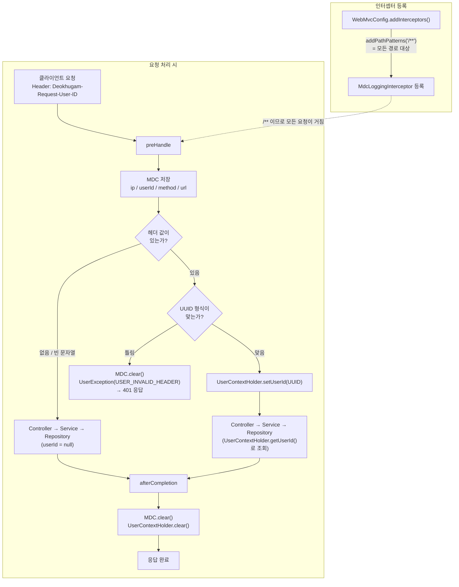

# 로깅 인터셉터 & UserContextHolder 가이드

요청마다 "누가, 어디서, 어떤 API를 호출했는지"를 로그에 자동으로 남기고, 요청 헤더의 사용자 ID를 코드 어디서든 꺼내 쓸 수 있게 하는 구조를 설명한다.

| 구성 요소 | 위치 | 역할 |
|---|---|---|
| `MdcLoggingInterceptor` | `common/logging/` | 요청 진입/종료 시점에 MDC·UserContextHolder를 채우고 정리 |
| `UserContextHolder` | `common/context/` | 요청 헤더의 사용자 ID를 `ThreadLocal`로 보관 |
| `WebMvcConfig` | `common/config/` | 인터셉터를 `/**` 전체 경로에 등록 |
| `logback-spring.xml` | `resources/` | MDC 값을 로그 한 줄에 찍는 패턴 정의 |
| `logstash.conf` | 프로젝트 루트 | 로그 한 줄을 필드로 쪼개 Elasticsearch로 전달 |

---

## 1. 전체 흐름

```
클라이언트
  │  Header: Deokhugam-Request-User-ID: <UUID>
  ▼
[ MdcLoggingInterceptor.preHandle ]
  ├─ MDC 에 ip / userId / method / url 저장   → 로그 패턴이 자동으로 출력
  └─ UserContextHolder 에 UUID 저장            → 서비스/컨트롤러에서 꺼내 사용
  ▼
Controller → Service → Repository   (이 안에서 찍는 모든 log 에 요청 정보가 붙음)
  ▼
[ MdcLoggingInterceptor.afterCompletion ]
  └─ MDC.clear() + UserContextHolder.clear()   → 스레드 오염 방지
```

### 플로우차트



---

## 2. HandlerInterceptor란?

컨트롤러로 들어오는 요청의 전/후에 공통 처리를 끼워 넣는 Spring MVC 인터페이스.

| 메서드 | 호출 시점 | 비고 |
|---|---|---|
| `preHandle` | 컨트롤러 호출 **전** | `false` 반환 시 컨트롤러가 실행되지 않음 |
| `postHandle` | 컨트롤러가 **정상 종료**된 후 | 컨트롤러에서 예외가 나면 호출되지 않음 |
| `afterCompletion` | 응답 처리가 **끝난 후** | 예외가 나도 항상 호출됨 → **정리 작업은 여기서** |

이 프로젝트는 `preHandle`에서 값을 채우고 `afterCompletion`에서 비운다.

---

## 3. MDC란? (로그에 요청 정보가 붙는 원리)

MDC(Mapped Diagnostic Context)는 SLF4J가 제공하는 **스레드별 key-value 저장소**다.
여기에 값을 넣어두면 `log.info(...)`를 호출할 때마다 logback 패턴의 `%X{키}` 자리에 그 값이 자동으로 찍힌다.
덕분에 모든 로그 호출부에서 IP·유저 ID를 직접 넘기지 않아도 된다.

### MDC 키

| 상수 | 키 | 값 |
|---|---|---|
| `REQUEST_IP` | `requestedIp` | 클라이언트 IP |
| `REQUEST_ID` | `requestedUserId` | `Deokhugam-Request-User-ID` 헤더 원본 값 |
| `REQUEST_METHOD` | `requestMethod` | HTTP 메서드 |
| `REQUEST_URL` | `requestUrl` | 요청 URI |

### 출력 예시

```
2026-10-20 14:03:21.512 [http-nio-8080-exec-1] INFO  [c.s.d.review.ReviewService] [127.0.0.1] [3f2b...-uuid] [POST] [/api/reviews] - 리뷰 생성 완료
```

헤더가 없는 요청은 `%X{키:--}` 설정 때문에 해당 자리에 `-`가 찍힌다.

> ⚠️ `logback-spring.xml`의 `LOG_PATTERN`/`FILE_LOG_PATTERN`과 `logstash.conf`의 grok 패턴은 **짝**이다.
> 필드 순서·개수를 바꾸면 반드시 둘 다 수정할 것. 안 맞으면 Kibana에서 `_grokparsefailure`가 발생한다.

---

## 4. UserContextHolder (요청 헤더 userId 중앙 관리)

### 왜 만들었나

헤더(`Deokhugam-Request-User-ID`)를 읽는 코드를 컨트롤러마다 `@RequestHeader`로 반복하면
- 헤더 이름 오타·누락이 곳곳에 퍼지고
- UUID 파싱/검증 로직이 중복되며
- 서비스 계층까지 userId를 파라미터로 계속 넘겨야 한다.

그래서 **인터셉터 한 곳에서만 헤더를 읽고 검증**한 뒤, `ThreadLocal`에 담아 필요한 곳에서 꺼내 쓰도록 중앙화했다.

### ThreadLocal이란?

스레드마다 **독립된 변수 공간**을 주는 자바 기능. Tomcat은 요청 1건을 스레드 1개가 처리하므로,
요청 시작 시 넣어둔 값은 같은 요청 처리 중 어디서든(컨트롤러·서비스·리포지토리) 꺼낼 수 있고,
다른 요청(다른 스레드)의 값과는 섞이지 않는다.

### API

```java
UserContextHolder.setUserId(UUID userId); // 인터셉터가 호출 (직접 호출 금지)
UUID userId = UserContextHolder.getUserId(); // 헤더가 없으면 null
UserContextHolder.clear();                   // 인터셉터가 호출 (직접 호출 금지)
```

### 사용 예

```java
@Service
public class ReviewService {
    public void deleteReview(UUID reviewId) {
        UUID requestUserId = UserContextHolder.getUserId();
        if (requestUserId == null) {
            throw new UserException(UserErrorCode.USER_INVALID_HEADER);
        }
        // ... 작성자 검증 등
    }
}
```

### 인터셉터의 헤더 처리 규칙

| 헤더 상태 | 동작 |
|---|---|
| 없음 / 빈 문자열 | 통과. `UserContextHolder.getUserId()`는 `null` (로그인 불필요 API용) |
| 올바른 UUID | `UserContextHolder`에 저장 |
| UUID 형식이 아님 | MDC 정리 후 `UserException(USER_INVALID_HEADER)` → **401** 응답 |

> 인증이 필요한 API는 `null` 여부를 서비스에서 직접 확인해야 한다. 인터셉터는 "있으면 검증·저장"까지만 한다.

### 정리(clear)가 중요한 이유

서버는 **스레드 풀**을 재사용한다. `afterCompletion`에서 비우지 않으면
다음 요청이 같은 스레드를 배정받았을 때 **이전 사용자의 ID가 그대로 남아** 다른 사람 권한으로 동작하는 사고가 날 수 있다.
인터셉터가 `afterCompletion`(예외 시에도 호출)에서 `MDC.clear()`와 `UserContextHolder.clear()`를 항상 실행한다.

---

## 5. 사용 시 주의사항

### ThreadLocal은 다른 스레드와 공유되지 않는다

`UserContextHolder`(ThreadLocal)와 MDC는 **요청을 처리하는 스레드에만** 값이 있다.
`@Async`처럼 별도 스레드풀에서 실행되는 코드에서는 `UserContextHolder.getUserId()`가 `null`이고, 로그에도 요청 정보(`requestedIp` 등)가 `-`로 찍힌다.

### 해결: TaskDecorator로 값 복사

`TaskDecorator`는 작업을 스레드풀에 넘기기 직전에 감싸서, **요청 스레드의 값을 캡처해 작업 스레드에 심어주고, 작업이 끝나면 비워주는** 역할을 한다.

```java
public class ContextCopyingTaskDecorator implements TaskDecorator {

    @Override
    public Runnable decorate(Runnable runnable) {
        // 1. 요청 스레드에서 실행됨 → 현재 값을 캡처
        UUID userId = UserContextHolder.getUserId();
        Map<String, String> mdc = MDC.getCopyOfContextMap();

        return () -> {
            try {
                // 2. 작업 스레드에서 실행됨 → 캡처한 값을 심기
                if (userId != null) {
                    UserContextHolder.setUserId(userId);
                }
                if (mdc != null) {
                    MDC.setContextMap(mdc);
                }
                runnable.run();
            } finally {
                // 3. 스레드풀 재사용 대비 반드시 정리
                MDC.clear();
                UserContextHolder.clear();
            }
        };
    }
}
```

```java
@Configuration
@EnableAsync
public class AsyncConfig {

    @Bean
    public Executor taskExecutor() {
        ThreadPoolTaskExecutor executor = new ThreadPoolTaskExecutor();
        executor.setCorePoolSize(4);
        executor.setMaxPoolSize(8);
        executor.setThreadNamePrefix("async-");
        executor.setTaskDecorator(new ContextCopyingTaskDecorator());
        executor.initialize();
        return executor;
    }
}
```

이렇게 등록한 executor에서 실행되는 `@Async` 메서드는 요청 스레드와 같은 userId·MDC 값을 볼 수 있다.

TaskDecorator 대신, 컨트롤러에서 `UserContextHolder.getUserId()`로 꺼낸 userId를 `@Async` 메서드의 파라미터로 직접 전달하는 방법도 있다.

현재 프로젝트에서는 `@Async`를 쓰는 곳이 없어 TaskDecorator 구성은 오버헤드라고 판단해 **적용하지 않았다.** 비동기 처리가 필요해지면 그때 도입을 검토한다.

> 참고: [ThreadLocal과 TaskDecorator 관련 글](https://astrid-dm.tistory.com/616)

---

## 6. 새 MDC 키를 추가하려면

1. `MdcLoggingInterceptor`에 상수 추가 후 `preHandle`에서 `MDC.put`
2. `logback-spring.xml`의 `LOG_PATTERN`, `FILE_LOG_PATTERN`에 `[%X{새키:--}]` 추가
3. `logstash.conf` grok 패턴에 `\[%{DATA:필드명}\]`을 **같은 위치**에 추가
4. 이 문서의 MDC 키 표 갱신
